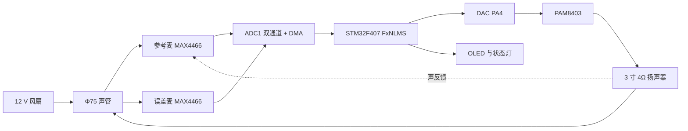
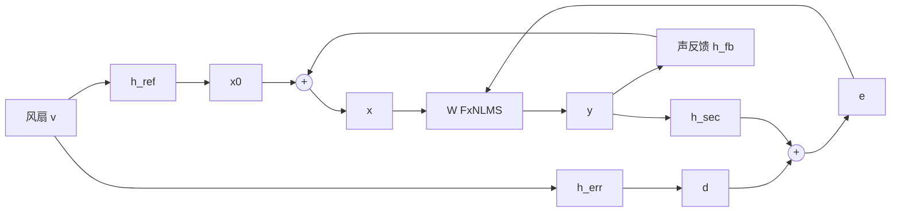
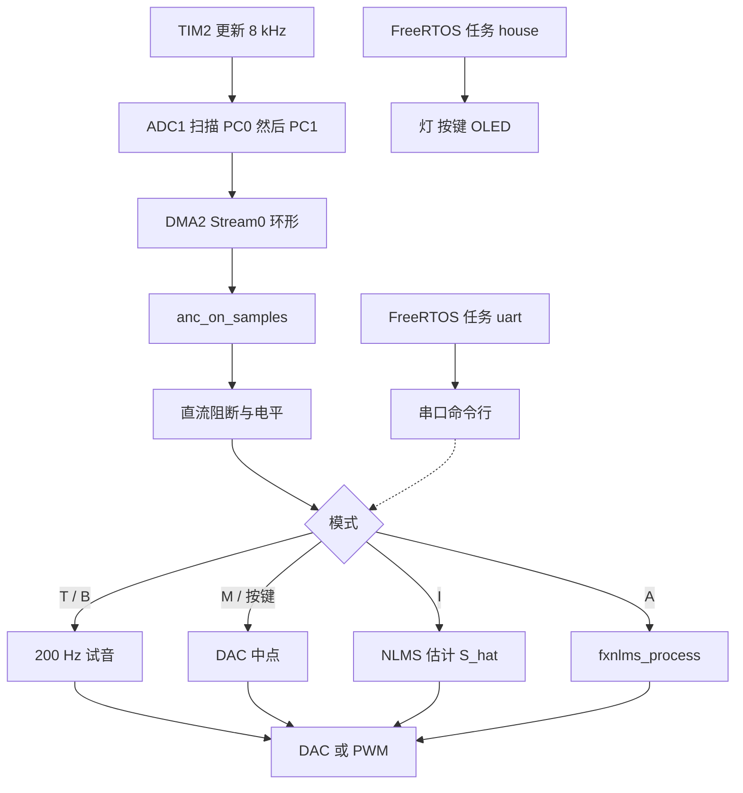

# 总体设计架构

武汉理工大学课程设计「基于 STM32F407 的管道主动降噪」的总览。读这一篇可以知道系统由哪些块组成、各块的接口，以及细节写在哪一篇。框图、公式、引脚表和实测步骤仍以原文档为准，这里不重复展开。

| 要查的内容 | 文档 |
| --- | --- |
| 硬件闭环、信号流、逐点中断 | [系统结构](系统结构.md) |
| LMS → FxNLMS、声管模型和仿真数字 | [算法推导](算法推导.md) |
| 8 kHz 与 100–200 μs 电延迟 | [时延预算](时延预算.md) |
| F407VET6 / Discovery 引脚和 CubeMX | [引脚分配](引脚分配.md) |
| 从闪灯到闭环的顺序 | [上板清单](上板清单.md) |
| 分频段 dB 怎么量 | [实测步骤](实测步骤.md) |
| 口头选题 | [选题说明](选题说明.md) |
| 物料、接线、样机尺寸 | [物料清单](../hardware/物料清单.md)、[接线](../hardware/接线.md)、[三维模型](../cad/README.md) |

## 1. 课题目标与指标

在一根细管里做**前馈**主动降噪。风扇噪声先到达参考麦克风，STM32F407 上的 FxNLMS 逐点算出反相声波，扬声器从三通注入管内，误差麦克风修正权重。管径小于平面波截止波长时，100–400 Hz 只以平面波传播，在出风口前抵消，下游整段都安静。

课程指标（写进报告的数，不是仿真读数）：

- 目标频段 **100–400 Hz**。
- 出风口处、不计权的该频段声压级下降 **不少于 10 dB**，现场不啸叫。
- 控制器是 **STM32F407**，算法是 **FxNLMS**。
- 至少两路传感器、两类执行器。
- **FreeRTOS** 负责任务调度，对应优秀档；采样中断不进内核。
- 实物是可在宿舍组装的管道模型；控制板以后自画，嘉立创打样，外形不超过 **100 × 100 mm**。

仓库里已经对齐的是离线仿真和可编译固件。仿真在无声反馈、风扇状噪声上给出 100–400 Hz **21.2 dB**（纯线谱 25.3 dB；名义声反馈下步长降到 0.10 时 15.1 dB）。这些是数值实验。实物降噪量只认 [实测步骤](实测步骤.md) 里的 `sim/measure_wav.py`。

## 2. 物理布局

坐标原点是风扇出风面。声速按 343 m/s。样机尺寸在 `cad/parameters.py`，生成后的坐标表在 `cad/export/layout.json`。主管是外径 **Φ75 mm** 的亚克力直管（默认壁厚 2 mm，内径 71 mm），三通和后腔管帽是 **dn75 PVC**。上游管切 380 mm，下游管切 220 mm。

| 站点 | x (mm) | 说明 |
| --- | ---: | --- |
| 风扇出风面 | 0 | 8025 风扇在管外 |
| 参考麦克风 | 150 | 方案下限，避开叶片附近的湍流 |
| 三通轴线 / 声注入点 | 428 | 纸盆在支管承口端面，距轴线再 88 mm |
| 误差麦克风 | 578 | 三通轴线下游 150 mm，齐平安装 |
| 出风口 | 696 | 误差麦后再留约 118 mm |

参考麦到误差麦的一次路径是 428 mm（约 1.25 ms）。扬声器纸盆到误差麦还要加上约 88 mm 支管，次级路径按 238 mm（约 0.69 ms）计。电延迟按预算上沿 200 μs 时，因果余量是 **354 μs**（约 2.8 个 8 kHz 采样）。余量为正，反相声波仍先于直达声到达误差麦。三通「端面到轴线」若不是 88 mm，只改 `CENTER_TO_FACE` 再跑 `cad/build.py`。几何和这笔账的对照在 [时延预算](时延预算.md)。

仿真用的是更短的抽象圆管，不读 CAD：参考麦 150 mm，扬声器 400 mm，误差麦 550 mm，管口 650 mm，内半径 35 mm。第一阶高次模截止约 **2871 Hz**（\(f_c = 1.841\,c/(2\pi a)\)）。100–400 Hz 远低于截止频率，控制按平面波做。仿真几何没有把 dn75 支管算进次级路径，实物以样机表为准。

控制板是一块 100 × 100 × 1.6 mm 的占位 FR4，架在喇叭正上方，用两根夹在主管上的立柱托住，底板和管帽之间留 5 mm 气隙。麦克风线沿管顶线鞍走，喇叭线和风扇 12 V 走侧面另一道槽。

## 3. 硬件架构

四个功能块和课程方案一致。麦克风必须是**固定增益**。带 AGC 的模块会把次级路径变成时变的，自适应滤波器会发散。



| 模块 | 器件 | 作用 |
| --- | --- | --- |
| 传感器 ×2 | MAX4466 ×2，**3.3 V** | 参考 \(x(n)\)、误差 \(e(n)\)。输出偏置约 1.65 V，直流耦合进 ADC |
| 控制器 | STM32F407VET6 最小系统板，168 MHz，硬件 FPU | 逐点 FxNLMS，不做块缓冲 |
| 次级声源 | PAM8403（5 V）+ 3 寸、4 Ω、约 5 W 扬声器 | 反相声波 \(y(n)\)，装在 PVC 三通上 |
| 第二类执行器 | 0.96 寸 SSD1306 OLED + 四只状态灯 | 模式、步长、相对电平和电源 / 辨识 / 收敛 / 故障 |
| 噪声源 | 12 V 8025 风扇 | 可控噪声源，不计入必须的第二类执行器 |

默认板的引脚摘要（完整表和「不要占用」的脚在 [引脚分配](引脚分配.md)）：

| 功能 | 引脚 |
| --- | --- |
| 参考麦 / 误差麦 | PC0（ADC123_IN10）/ PC1（ADC123_IN11） |
| 反相输出 | PA4，DAC_OUT1，缓冲开 |
| 串口 | USART1，PA9 TX / PA10 RX，115200 8N1 |
| OLED | I2C2，PB10 SCL / PB11 SDA，地址先 0x3C 再 0x3D |
| 心跳 / 辨识灯 | PA6 D2、PA7 D3，低电平点亮 |
| 收敛 / 故障灯 | PE5 / PE6，高电平，脚 → 510 Ω → LED → GND |
| 按键 | K0 = PE4、K1 = PE3，对地，低有效；K_UP = PA0，高有效 |

PA0 是板上的 K_UP，不能当参考麦。每路麦到 ADC 串 2.2 kΩ、脚上对地 22 nF（抗混叠，截止约 3.3 kHz）。PA4 经 10 μF 隔直再进 PAM8403，功放输入侧用 1.5 kΩ 与 22 nF 做重建滤波。PAM8403 用 5 V，不要用 MCU 的 3.3 V 去推它。

静音是**软件静音**：串口 `M`、三只按键，以及上电默认模式，都把 DAC 写成中点（`hw_dac_write(0)` → 码值 2048）。固件不接 PAM8403 的 MUTE / SHDN，功放保持上电，喇叭靠 DAC 中点安静。权重在 `M` 时保留；进入 `A` 时才清状态。

Discovery 是另一套 CMake 开关（`-DANC_BOARD_DISCOVERY=ON`）：反相输出改到 PC6 的 PWM，串口改到 USART2。默认烧录目标是 VET6。

## 4. 信号与算法架构

误差麦克风处是声压相加，不是电路里相减：

\[
e(n) = d(n) + (s * y)(n)
\]

\(d\) 是风扇经一次路径到达误差麦的声压，\(s\) 是扬声器到误差麦的次级路径（功放、喇叭、管内传播）。参考麦同时吃到声反馈 \(x = x_0 + f * y\)。控制器只看得到 \(x\) 和 \(e\)。\(W(z)\) 要逼近的是一次路径与次级路径之比，而且必须因果：参考麦到误差麦的声延迟，要长于电延迟加上扬声器到误差麦的声延迟。



FxNLMS 用次级路径估计 \(\hat S\) 把参考滤成 \(x_f\)，再按归一化步长更新。因为 \(e\) 随 \(y\) 增加，更新是减号。泄漏 \(\lambda\)、输出增益和限幅写在同一拍里。推导和极性约定在 [算法推导](算法推导.md)。

\[
\mathbf{w}(n+1)
  = (1-\lambda)\,\mathbf{w}(n)
  - \frac{\mu\, e(n)}{\|\mathbf{x}_f\|^2 + \delta}\, \mathbf{x}_f(n)
\]

阶数和采样率在 `firmware/src/anc_config.h` 与 `sim/duct_anc/config.py` 对齐：8 kHz，控制滤波器 96 阶，\(\hat S\) 160 阶。固件默认 \(\mu = 0.10\)（名义声反馈下仿真仍有 15.1 dB）；仿真无反馈曲线用 \(\mu = 0.20\)。\(\mu \ge 0.30\) 在仿真里发散；\(\hat S\) 估晚 2 个采样也会发散。

辨识和降噪分开。风扇关掉之后，`I` 向扬声器注入白噪声（幅度 0.30，默认 4 s），用 NLMS 估计 \(\hat S\)。回归量是**注入扬声器的电信号**，不是参考麦，声反馈因此不进辨识。仿真里 `identify_secondary()` 用同一做法。辨识结束自动静音。`F` / `R` 把 \(\hat S\) 写入或读出 Flash 扇区 7（`0x08060000`）；程序链接在前 384 KB，擦除还没有在芯片上跑过。

仿真里次级路径白噪声辨识的验证 NMSE 是 −42.5 dB。朴素 LMS（把次级路径当成 1）在同一段风扇噪声上只有 9.4 dB，低于 10 dB 课程线。全部曲线在 `sim/figures/`。

## 5. 软件分层

采样链路是定时器触发、逐点中断。FreeRTOS 只跑人机，不跑滤波器。



`main` 在时钟和外设初始化之后创建两个**静态**任务再启动调度器：`uart`（优先级 3，每 2 ms 轮询一行命令）和 `house`（优先级 2，每 10 ms 刷新灯、按键和 OLED）。内核是 FreeRTOS V11.2.0，只开静态分配。DMA 完成中断优先级是 1，高于系统调用上限（`configMAX_SYSCALL_INTERRUPT_PRIORITY`），里面不调用内核 API，避免调度把这一拍的电延迟拉出 100–200 μs。

| 命令 | 是否调用 FxNLMS | 行为 |
| --- | --- | --- |
| `P` | 否 | 打印状态和 PC0/PC1 的 12 位原码 |
| `S` | 否 | 约 4 s 麦克风码流，不改变当前模式 |
| `T` | 否 | 200 Hz 长音，确认功放和喇叭 |
| `B` | 否 | 三声 200 Hz 短音后静音 |
| `M` | 否 | 静音，权重保留 |
| `I` | 辨识，不是 FxNLMS | 风扇关，注入白噪声，估计 \(\hat S\) |
| `A` | 是 | 用当前 \(\hat S\) 做前馈 |
| `U/K/G/C/J` | — | 改 μ、泄漏、输出增益、限幅、辨识步长 |
| `F` / `R` | — | 扇区 7 保存或读出 \(\hat S\)。`F` 必须先 `M` |

`P`、`S`、`T`、`B`、`M` 是连接测试。`I` 和 `A` 才进入第 4 步。

算法本体在 `firmware/algo/fxnlms.c`，不包含片上外设头文件。同一份 C 在 PC 上由 `firmware/tests/` 对照 `sim/duct_anc/adaptive.py` 的 float32 向量。片上的 `anc_app.c` 只负责模式、直流阻断、增益保护和串口；`hw_periph.c` 负责时钟、TIM2、ADC、DMA、DAC 和 USART。

主机串口脚本 `tools/bringup_serial.py` **还不在 `main` 上**。它在未合并的 [PR #1](https://github.com/COSMOS-LYX/duct-anc-stm32/pull/1)（分支 `cursor/bringup-serial-31f8`）：按 115200 8N1 发送 `H`/`P`/`S`/`T`/`B`/`M`，并拒绝 `I` 和 `A`。当前 `main` 没有 `tools/` 目录，上板时直接用串口终端发同样的字母即可。

## 6. 仓库目录

| 路径 | 内容 |
| --- | --- |
| `sim/` | Python：LMS、FxLMS、FxNLMS，平面波声管，辨识，图和 pytest。`measure_wav.py` 算实测 WAV |
| `firmware/` | CMake + CMSIS 的 STM32F407 工程。`algo/fxnlms.c` 可在 PC 上单独编译 |
| `firmware/third_party/` | CMSIS、器件头、启动文件，以及裁过的 FreeRTOS 内核 |
| `docs/` | 本篇和结构、推导、时延、引脚、实测、上板、选题 |
| `hardware/` | 物料和接线。控制板仍是占位尺寸，还没有原理图工程 |
| `cad/` | CadQuery 样机。STEP/STL 在 `cad/export/`，渲染在 `cad/renders/` |

`main` 上没有 `tools/`。主机辅助脚本见上一节的 PR #1。

## 7. 上板与验证路径

先连接，后算法。第 3 步的 `P` 和 `T` 正常之前不要发 `I` 或 `A`。顺序的每一步在 [上板清单](上板清单.md)。

```bash
cd firmware
cmake -S . -B build -DCMAKE_TOOLCHAIN_FILE=toolchain-arm-none-eabi.cmake
cmake --build build
cmake --build build --target flash
```

`flash` 执行 `st-flash write duct_anc.bin 0x08000000`。串口是 USART1，**115200 8N1**。USB 转串口或蓝牙都可以：模块 RX 接 PA9，模块 TX 接 PA10，只共地。上电应打出 `duct-anc STM32F407VET6  8 kHz` 和 `bring-up: 1 clock/USART …`。D2 约每 500 ms 翻转；若约每 80 ms 闪一次，HSE 没锁上。

建议顺序：

1. 只接串口，确认时钟横幅。
2. 按 K0、K1、K_UP，串口应打出对应按键名并静音，D3 在按住时亮。
3. 麦用 3.3 V。`P` 看两路原码和 `ovr`（必须为 0），`S` 确认没有接反，`T`/`B` 听 200 Hz，`M` 立刻安静。
4. 风扇断电，`I` 辨识，`D` 看 \(\hat S\) 形状，需要时 `F` 写入 Flash。再开风扇，`U 0.10`、`G 0.5`、`C 0.9`，然后 `A`。
5. 静音和降噪各录一段 WAV，裁掉开头 2 s，在 `sim/` 下运行 `python measure_wav.py before.wav after.wav`。报告认 `100-400` 这一行。屏上的 `REL` 和串口 `rel` 只是误差麦电气电平相对进入 ANC 后第一秒的比值，不是声级计读数，也不能拿去对仿真的 21 dB。

PC 上不烧板也能核对算法：`cd sim && python -m pytest`，以及 `make -C firmware/tests`。

## 8. 与课程要求的对应

| 要求 | 本设计里落在哪 |
| --- | --- |
| 前馈管道 ANC，100–400 Hz，≥10 dB，不啸叫 | 第 1 节的指标。仿真超过 10 dB；实测只认 `measure_wav.py` |
| 传感器不少于 2 | 参考麦、误差麦，都是固定增益 MAX4466 |
| 执行器不少于 2 类 | 次级声源（PAM8403 + 喇叭）；人机（OLED + 四只灯）。风扇只作噪声源 |
| 实物管道模型 | Φ75 亚克力主管 + dn75 PVC 三通和管帽，打印夹具，见 `cad/` |
| 自画 PCB，嘉立创 ≤100×100 | 模型里是这个尺寸的占位板，孔距边 3.5 mm。原理图和投板还没做 |
| FreeRTOS（优秀档） | `uart`、`house` 两个静态任务。采样 ISR 不调用内核 |
| 算法可先离线核对 | `firmware/algo/fxnlms.c` 与 `sim/` 共用同一更新式；主机测试不链片上外设 |
| 闭环前的连接测试 | `P`/`S`/`T`/`B`/`M` 不跑 FxNLMS。PR #1 的主机脚本也拒绝 `I`/`A` |
| 报告与演示 | 论文不少于 20 页；源码打包 RAR；演示不少于 3 分钟（辨识、收敛、降噪前后、OLED 和状态灯）。口头稿用 [选题说明](选题说明.md)，总体设计用本篇，公式和曲线用 [算法推导](算法推导.md)，尺寸用 [时延预算](时延预算.md) 和 [cad/README.md](../cad/README.md)，上板记录用 [上板清单](上板清单.md)，dB 用 [实测步骤](实测步骤.md) |

## 9. 建议阅读顺序

1. 本篇，确认目标和接口。
2. [系统结构](系统结构.md) 的三张图，对照第 3–5 节。
3. [算法推导](算法推导.md)，看更新式和仿真表，再跑 `sim/`。
4. [时延预算](时延预算.md) 和 [cad/README.md](../cad/README.md)，核对 354 μs 余量是否还成立。
5. 有板子之后按 [上板清单](上板清单.md) 走，用 [实测步骤](实测步骤.md) 出数。
