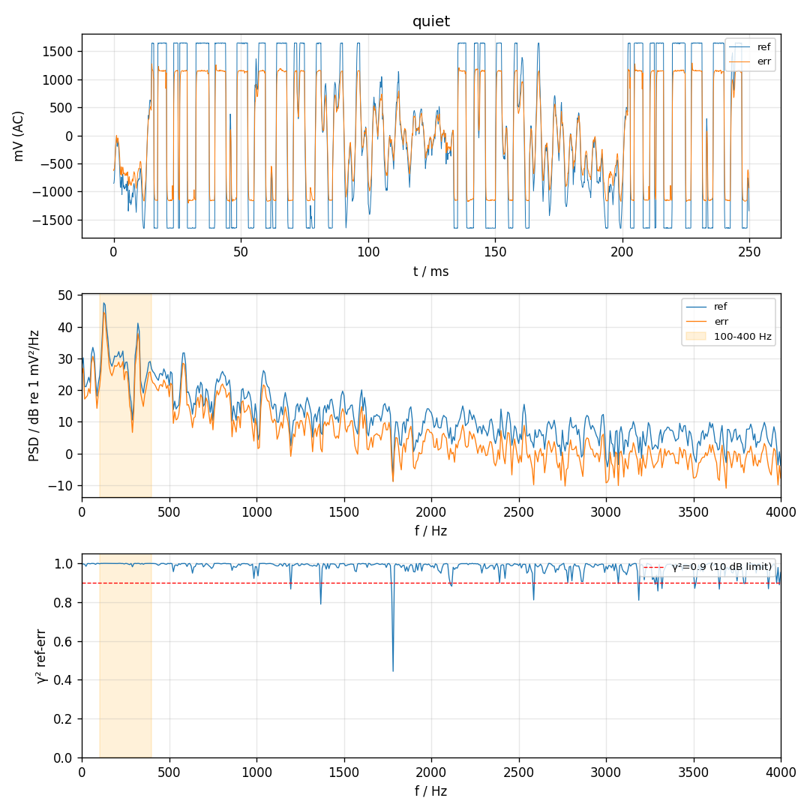
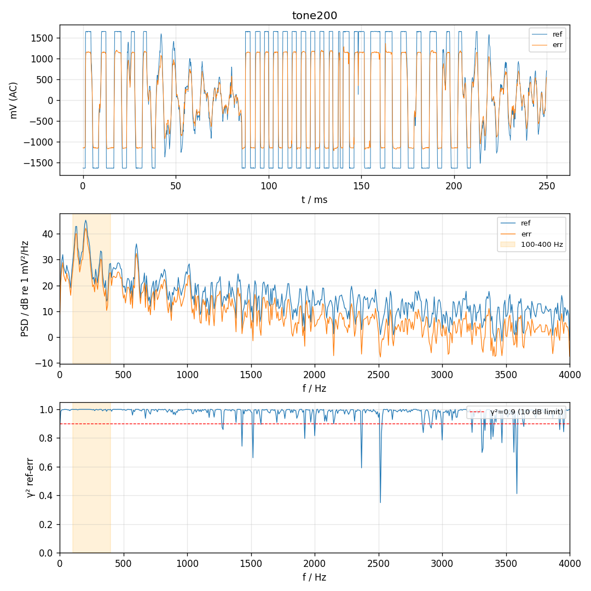

# 硬件自检 2026-11-08 16:55:40

固件：duct-anc-hwtest-0.1，波特率 9600，单音 200.0 Hz / amp 0.1

| 项目 | 结果 | 说明 |
| --- | --- | --- |
| 蓝牙 PING | PASS | 10/10 ok, avg RTT 54 ms |
| 时钟 168 MHz | PASS | sysclk=168000000 |
| ADC/DAC 无溢出 | PASS | ovr=0 udr=0 late=0 |
| ref 偏置 | FAIL | dc=1651 mV (应约 1650), rms=1227.57 mV, clip=1420 |
| err 偏置 | PASS | dc=1429 mV (应约 1650), rms=853.39 mV, clip=0 |
| 扬声器→ref | FAIL | 200 Hz 处 +13.8 dB (要求 ≥10.0 dB), clip=2157 |
| 扬声器→err | PASS | 200 Hz 处 +13.7 dB (要求 ≥10.0 dB), clip=0 |
| 通道顺序 | PASS | ref +1.2 dB, err +1.0 dB |

