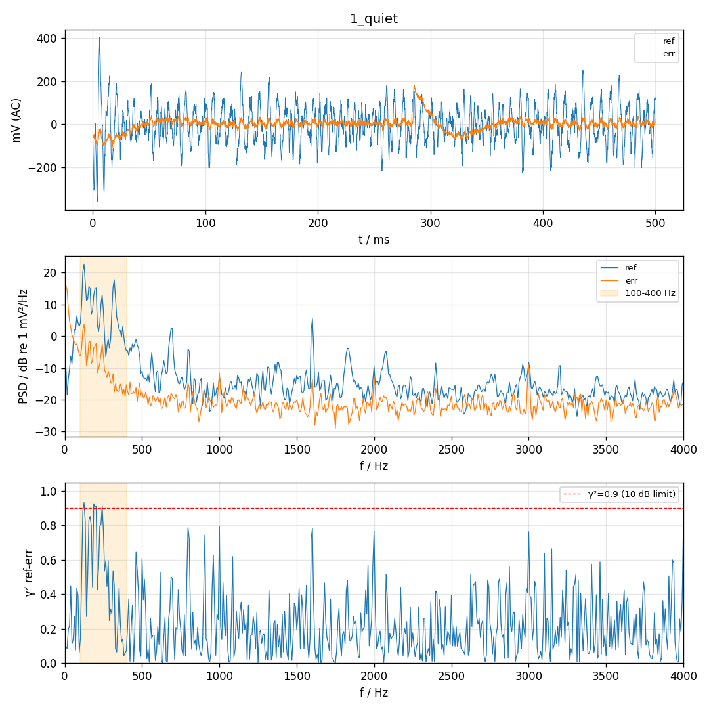
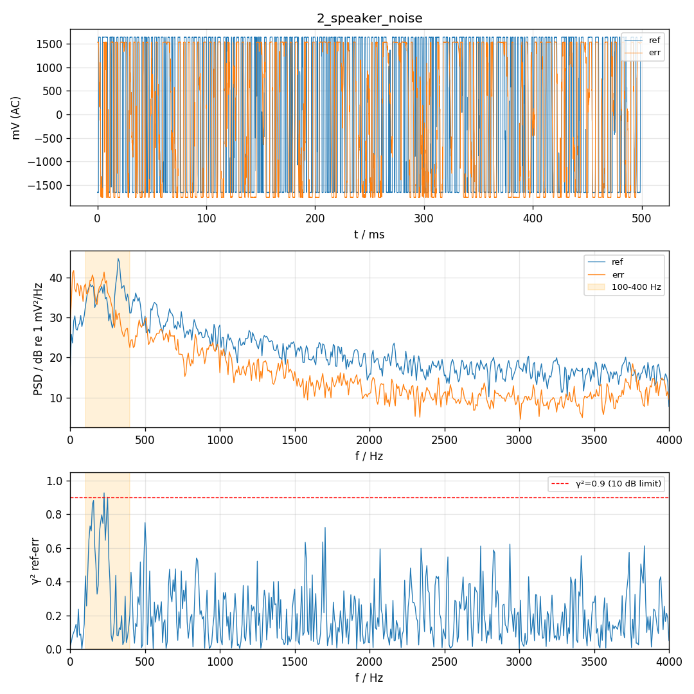
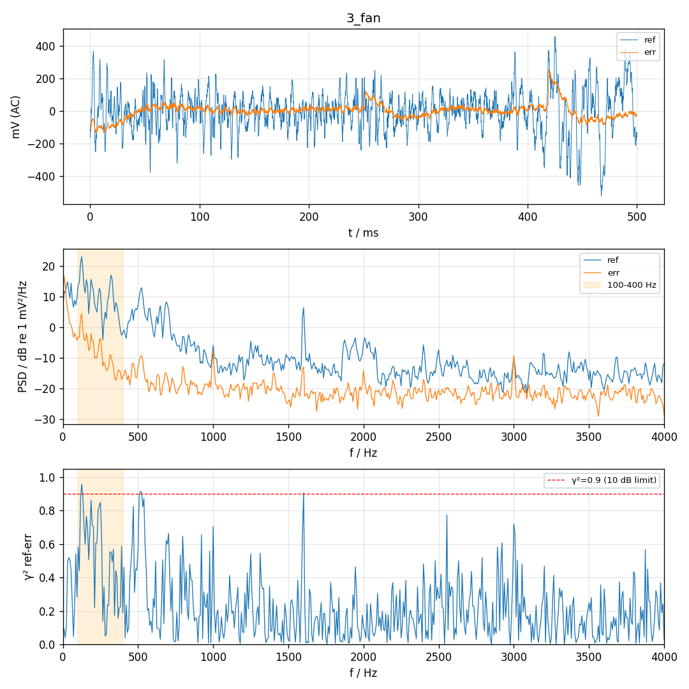

# 麦克风测试 2026-11-08 18:48:39

帧数 4000（0.50 s），扬声器白噪声 amp 0.1；几何：ref→err 428 mm，喇叭→ref 366 mm，喇叭→err 238 mm。风扇噪声误差麦主要频率：8, 16, 23, 31, 125 Hz

| 项目 | 结果 | 说明 |
| --- | --- | --- |
| ref 偏置 | PASS | dc=1651 mV (应约 1650) |
| ref 静音电平 | FAIL | rms=88.0 mV (要求 <50), clip=0 |
| err 偏置 | PASS | dc=1651 mV (应约 1650) |
| err 静音电平 | PASS | rms=33.2 mV (要求 <50), clip=0 |
| 两路独立 | PASS | 相关系数 0.265，滞后 2 样本，err≈0.09×ref |
| 敲击 ref | FAIL | ref +18.4 dB，err +23.6 dB（被敲的那只应明显更大） |
| 敲击 err | PASS | ref +16.6 dB，err +23.2 dB（被敲的那只应明显更大） |
| 扬声器→ref | FAIL | 100–400 Hz 比本底 +24.5 dB (要求 ≥10), clip=2142 |
| 扬声器→err | FAIL | 100–400 Hz 比本底 +41.5 dB (要求 ≥10), clip=1690 |
| 声程差·扬声器 | PASS | err 相对 ref -4 样本（≈-172 mm），按几何应 -3.0；负值表示误差麦离喇叭更近，符号反了多半是通道接反 |
| ref 风扇不削波 | FAIL | 占用量程 30%，clip=125（5%–90% 合适；过小说明增益偏低） |
| ref 风扇信噪比 | FAIL | 100–400 Hz 比本底高 0.7 dB（≥20 理想；要测出 10 dB 降噪至少 ≥12） |
| err 风扇不削波 | FAIL | 占用量程 12%，clip=10（5%–90% 合适；过小说明增益偏低） |
| err 风扇信噪比 | FAIL | 100–400 Hz 比本底高 0.6 dB（≥20 理想；要测出 10 dB 降噪至少 ≥12） |
| 相干性 100–400 Hz | FAIL | 平均 γ^2=0.52 → 前馈降噪理论上限约 3.2 dB |
| 声程差·风扇 | PASS | err 比 ref 晚 +8 样本（≈343 mm），按几何应 +10.0 |

