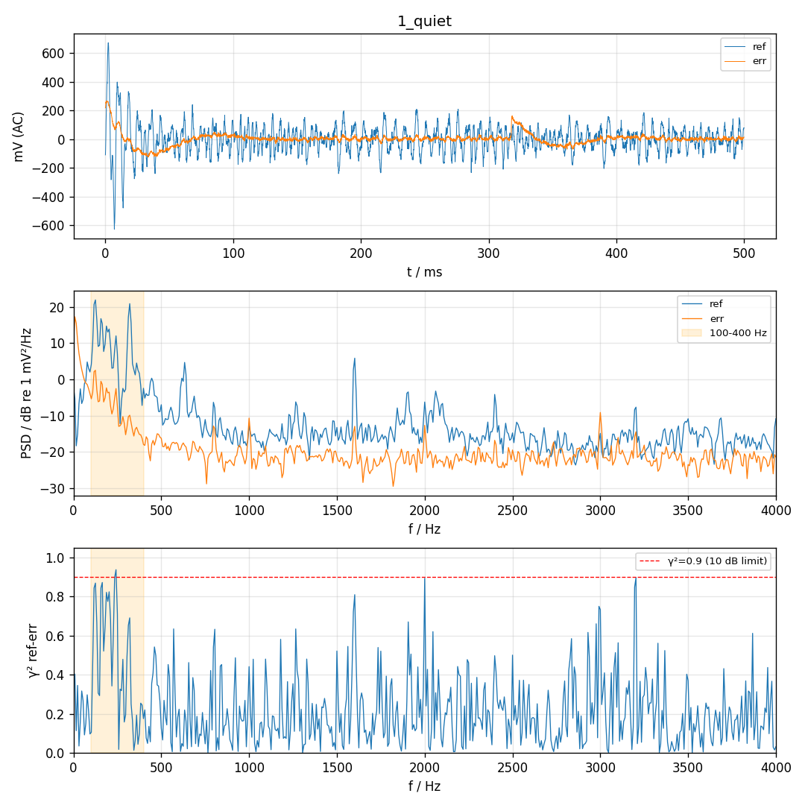
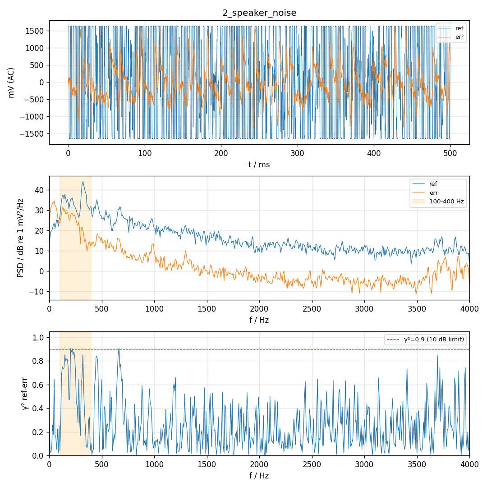
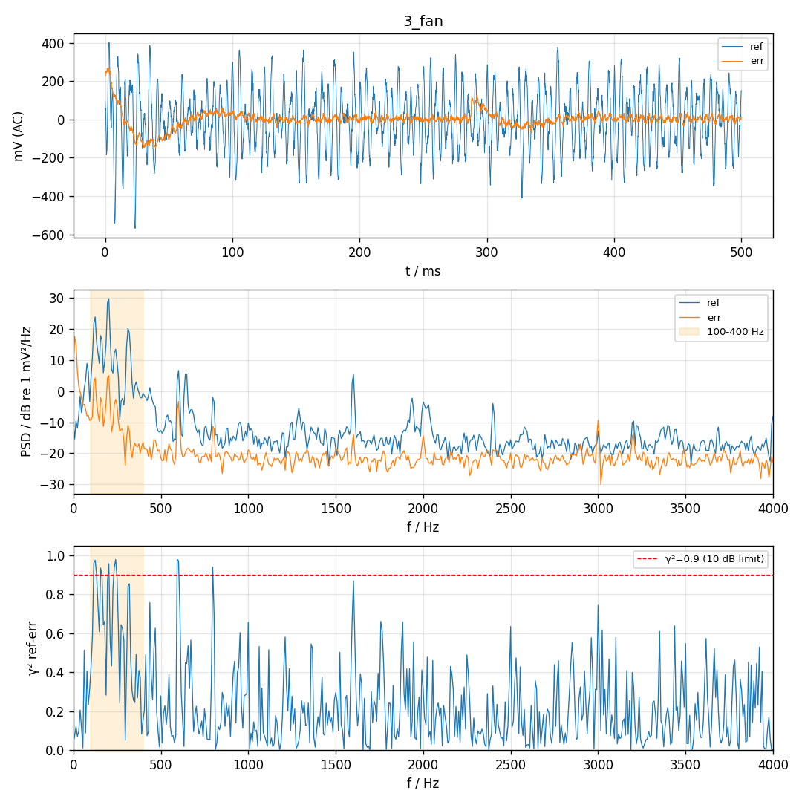

# 麦克风测试 2026-11-08 19:02:02

帧数 4000（0.50 s），扬声器白噪声 amp 0.02；几何：ref→err 428 mm，喇叭→ref 366 mm，喇叭→err 238 mm。风扇噪声误差麦主要频率：203, 195, 125, 117, 156 Hz

| 项目 | 结果 | 说明 |
| --- | --- | --- |
| ref 偏置 | PASS | dc=1651 mV (应约 1650) |
| ref 本底 100–400 Hz | FAIL | 78.4 mV (要求 <30)，全频带 91.2 mV，主峰 125 Hz，clip=0 |
| err 偏置 | PASS | dc=1651 mV (应约 1650) |
| err 本底 100–400 Hz | PASS | 9.4 mV (要求 <30)，全频带 33.6 mV，主峰 8 Hz，clip=0 |
| 两路独立 | PASS | 相关系数 0.258，滞后 2 样本，err≈0.11×ref |
| 敲击 ref | WARN | 新增 rms：ref 767 mV，err 553 mV（被敲的那只应更大） |
| 敲击 err | WARN | 新增 rms：ref 660 mV，err 482 mV（被敲的那只应更大） |
| 扬声器→ref | FAIL | 100–400 Hz 比本底 +23.3 dB (要求 ≥10), clip=2664  → 喇叭太响把麦打满了，用更小的 --amp（当前 0.02） |
| 扬声器→err | FAIL | 100–400 Hz 比本底 +31.3 dB (要求 ≥10), clip=9  → 喇叭太响把麦打满了，用更小的 --amp（当前 0.02） |
| 声程差·扬声器 | FAIL | err 相对 ref +10 样本（≈+429 mm），按几何应 -3.0；负值表示误差麦离喇叭更近，符号反了多半是通道接反 |
| ref 风扇不削波 | PASS | 占用量程 29%，clip=0（5%–90% 合适；过小说明增益偏低） |
| ref 风扇信噪比 | FAIL | 100–400 Hz 比本底高 5.3 dB（≥20 理想；要测出 10 dB 降噪至少 ≥12） |
| err 风扇不削波 | PASS | 占用量程 13%，clip=0（5%–90% 合适；过小说明增益偏低） |
| err 风扇信噪比 | FAIL | 100–400 Hz 比本底高 1.4 dB（≥20 理想；要测出 10 dB 降噪至少 ≥12）  → 开风扇前后几乎没变化：确认第 1 步时风扇已断电；若确实断电，说明这只风扇在 100–400 Hz 几乎不出声 |
| 相干性 100–400 Hz | FAIL | 平均 γ^2=0.59 → 前馈降噪理论上限约 3.9 dB |
| 声程差·风扇 | FAIL | err 比 ref 晚 +0 样本（≈0 mm），按几何应 +10.0 |

