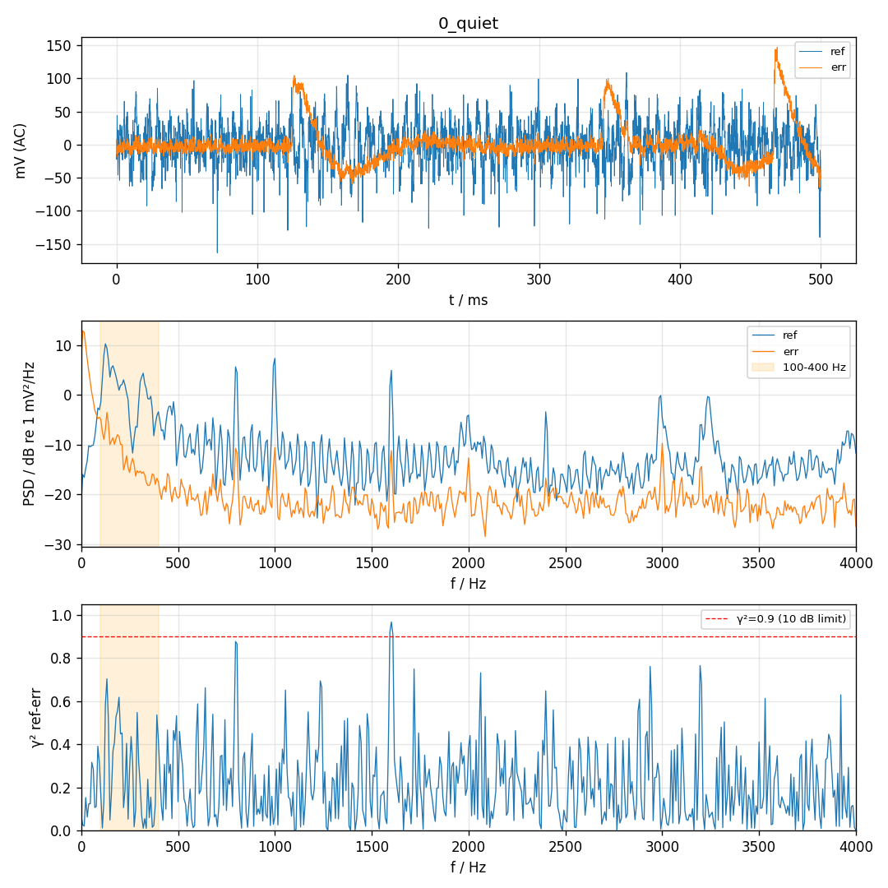
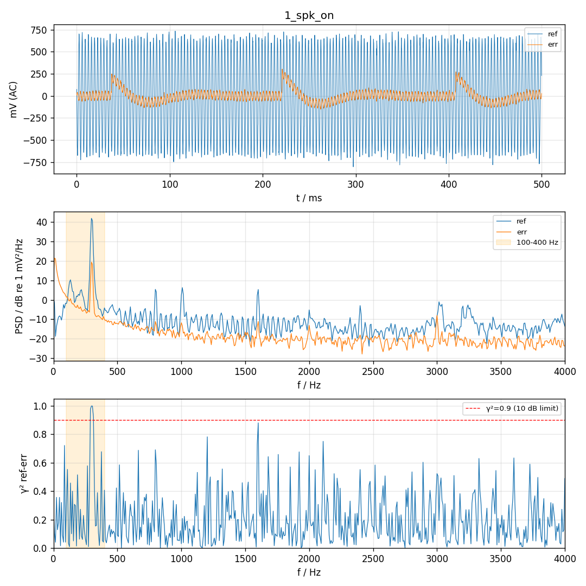
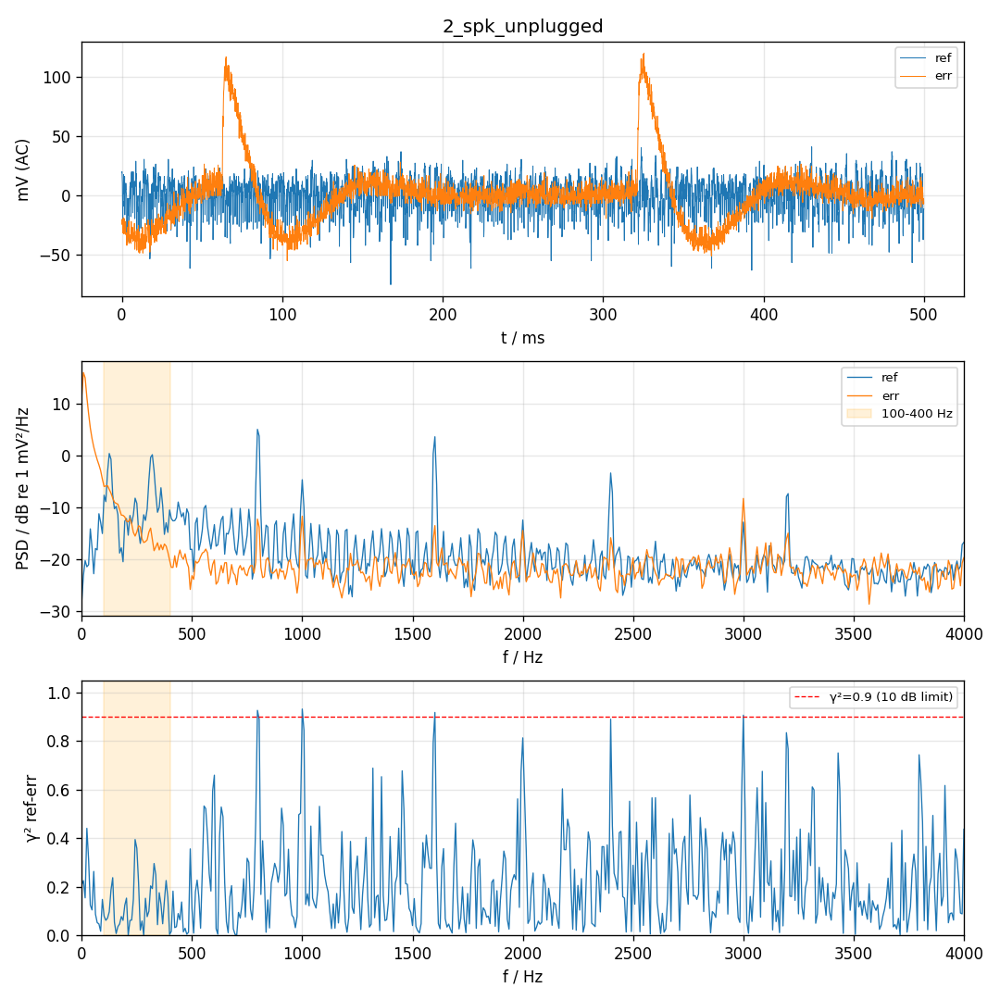
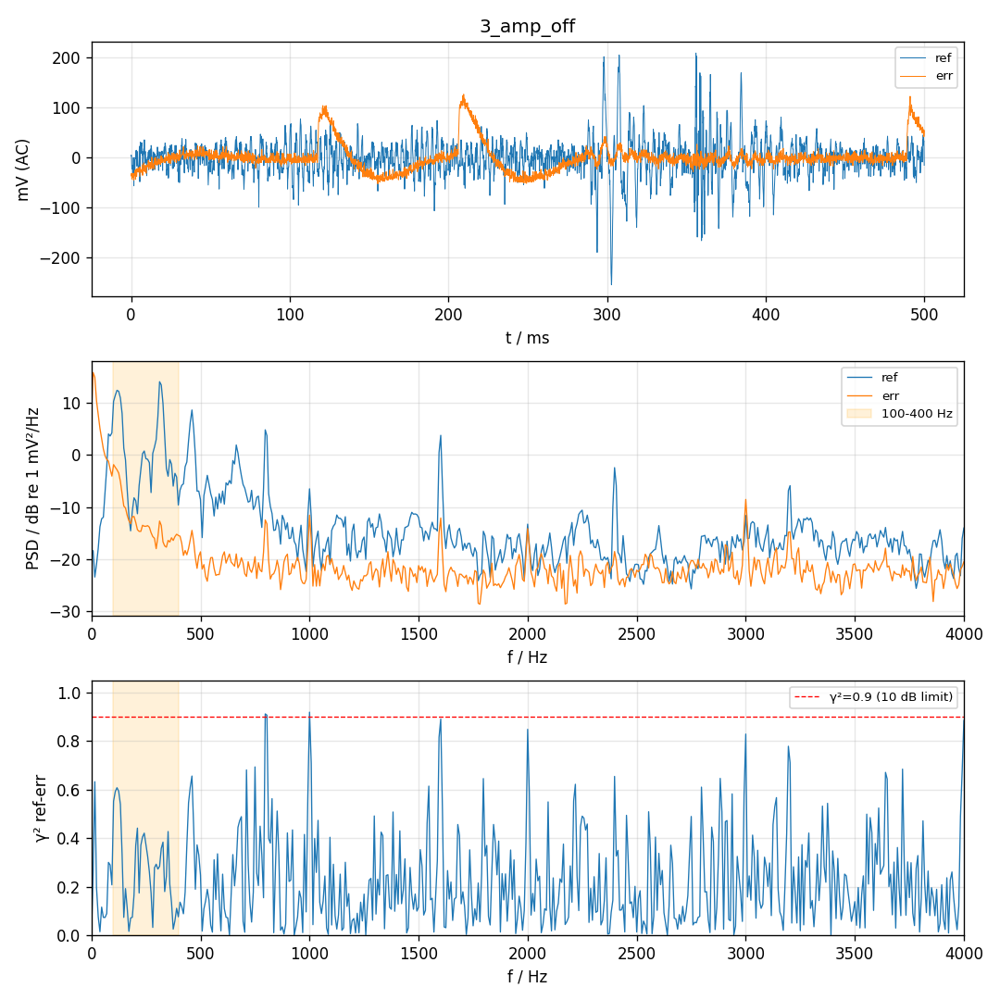
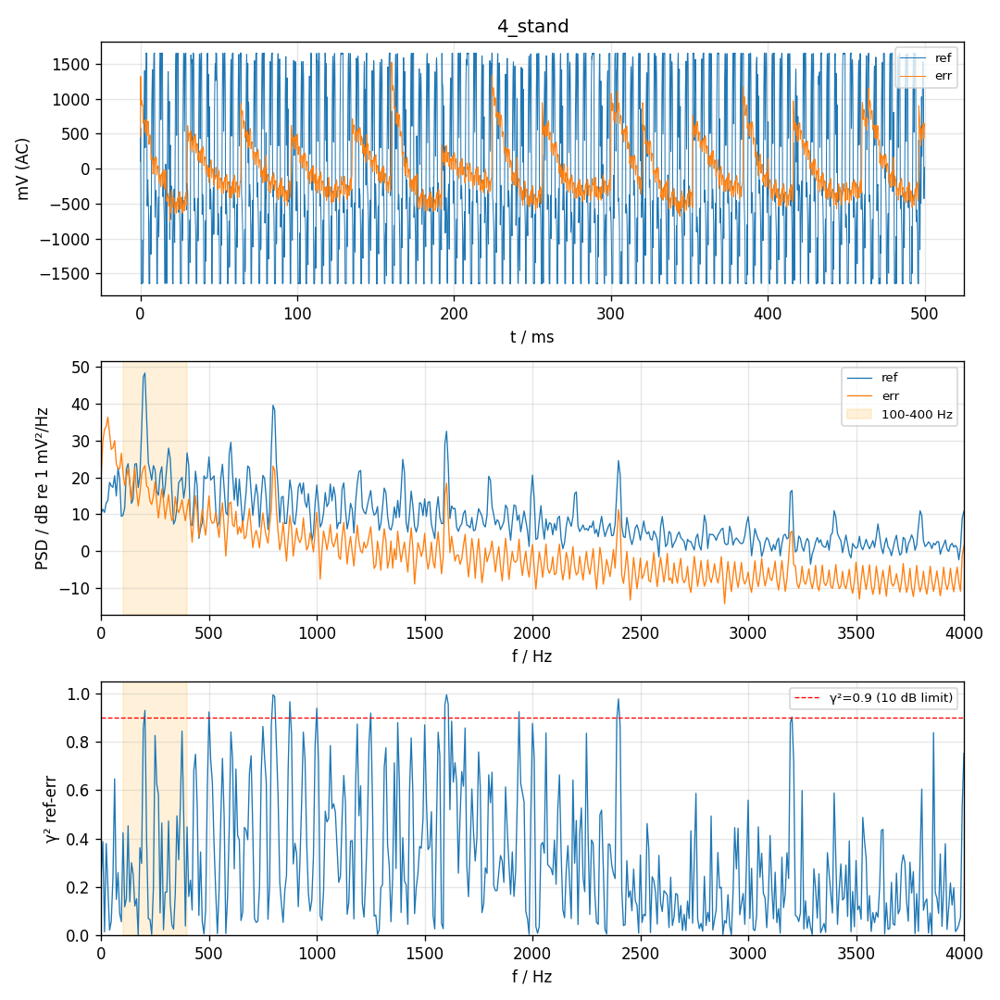
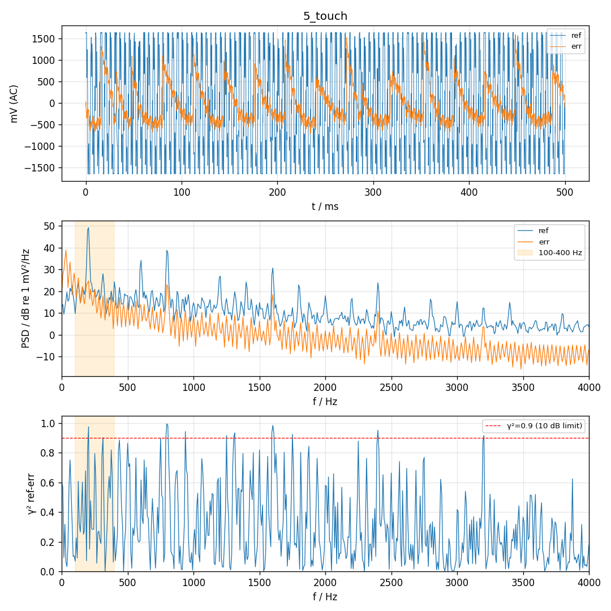
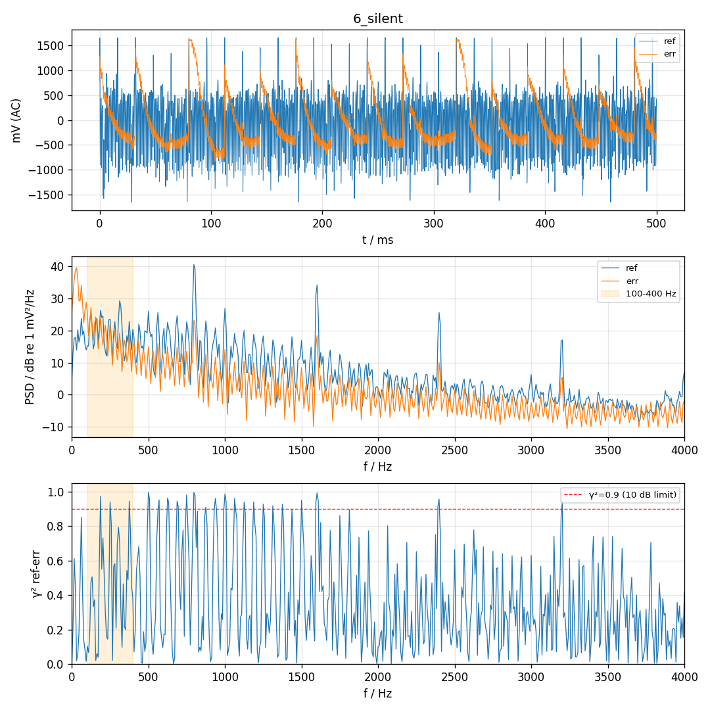

# P0 硬件对照 2026-11-10 10:34:55

帧数 4000，喇叭 300 Hz amp 0.02，声源 200 Hz，ref 目标 200–300 mV

| 段 | 单音 Hz | ref 单音 mV | err 单音 mV | ref−err dB | ref 3 次谐波 dB | err <80 Hz mV | err >80 Hz mV | ref clip | err clip |
| --- | --- | --- | --- | --- | --- | --- | --- | --- | --- |
| 0_quiet | 300 | 1.3 | 0.1 | +19.0 | -10.9 | 26.6 | 8.6 | 0 | 0 |
| 0_quiet@200Hz | 200 | 1.1 | 0.3 | +10.5 | 0.2 | 26.6 | 8.6 | 0 | 0 |
| 1_spk_on | 300 | 468.5 | 35.0 | +22.5 | -63.9 | 55.6 | 38.1 | 0 | 0 |
| 2_spk_unplugged | 300 | 0.7 | 0.1 | +16.2 | -7.2 | 24.5 | 6.6 | 0 | 0 |
| 3_amp_off | 300 | 0.5 | 0.2 | +6.3 | -2.9 | 26.4 | 7.9 | 0 | 0 |
| 4_stand | 200 | 990.0 | 51.1 | +25.7 | -19.3 | 334.1 | 167.0 | 583 | 0 |
| 5_touch | 200 | 1093.5 | 69.1 | +24.0 | -15.9 | 375.0 | 202.2 | 737 | 0 |
| 6_silent | 200 | 62.6 | 18.3 | +10.7 | -5.3 | 456.3 | 207.0 | 36 | 18 |

| 项目 | 结果 | 说明 |
| --- | --- | --- |
| 喇叭幅度 | PASS | 选用 amp 0.02；amp 0.02: ref clip=0 量程 46%，err clip=0 量程 16% |
| err 声学路径断开 | PASS | 300 Hz：接喇叭 35.0 → 拔线 0.1 mV（-50.8 dB，本底 0.14 mV） |
| ref 电串扰·功放通电 | PASS | 300 Hz：接喇叭 468.5 mV → 拔线 0.7 mV（-57.1 dB，本底 1.28 mV），约 0% 来自电路 |
| ref 电串扰·功放断电 | PASS | 300 Hz：接喇叭 468.5 mV → 断电 0.5 mV（-60.2 dB，本底 1.28 mV），约 0% 来自电路 |
| 串扰位置 | PASS | 参考麦里没有可测的电串扰；喇叭测试时参考麦削波是声学原因（喇叭支管离参考麦近），降低喇叭幅度即可。接喇叭时 err 相对 ref +11.8 样本（模 26.7），按几何应 -3.0 |
| ref 声源电平 | WARN | ref 990 mV（目标 200–300）  → 调手机音量调小 |
| ref 不削波 | FAIL | 占用量程 100%，clip=1184 |
| err 不削波 | FAIL | 占用量程 69%，clip=1 |
| ref 谐波 | FAIL | ref 2/3 次 -23/-19 dB，err 2/3 次 -16/-11 dB  两麦都有 → 手机喇叭失真，调小音量 |
| 低频来源 | WARN | err <80 Hz：静音 26.6 / 支架 334.1 / 贴管 375.0 / 静音文件 456.3 mV。不播放也有 → 与声音无关：支架振动、管口气流或手机位置 |

