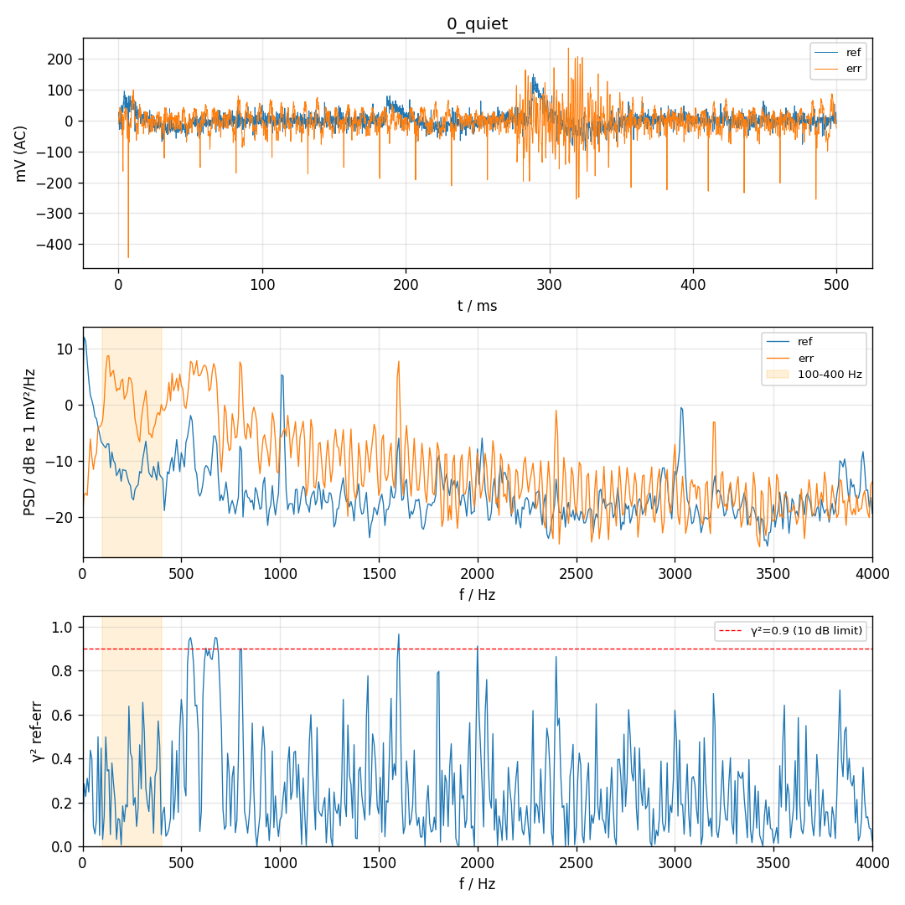
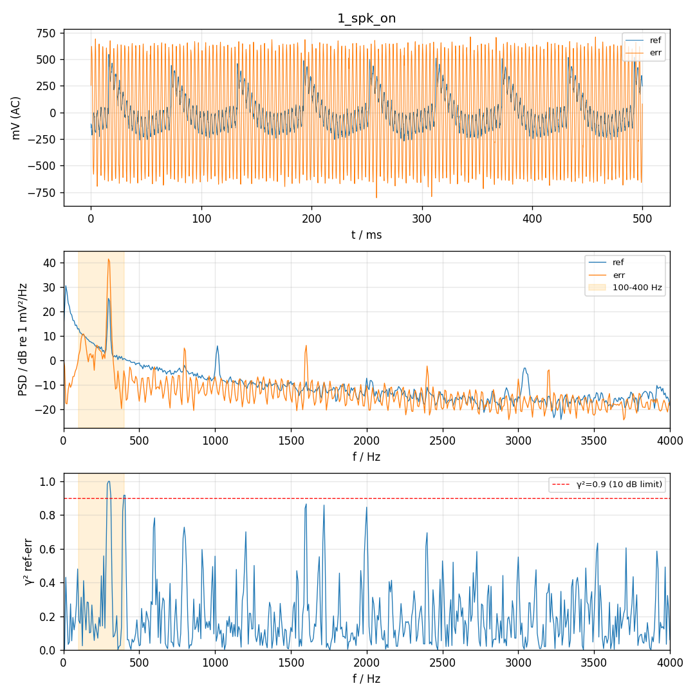
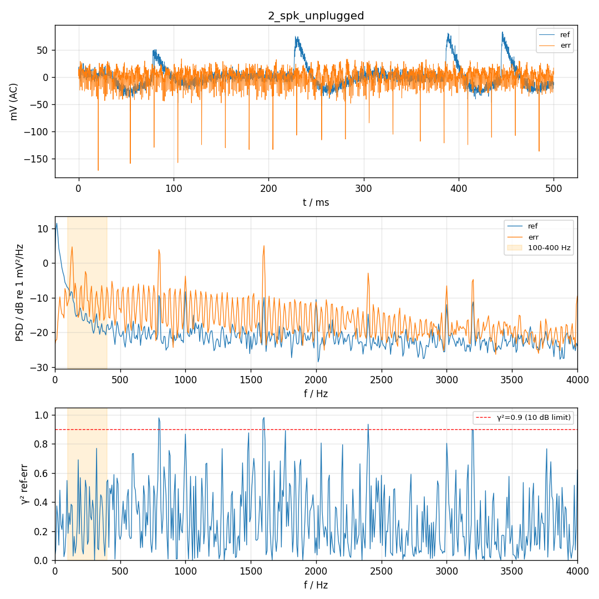
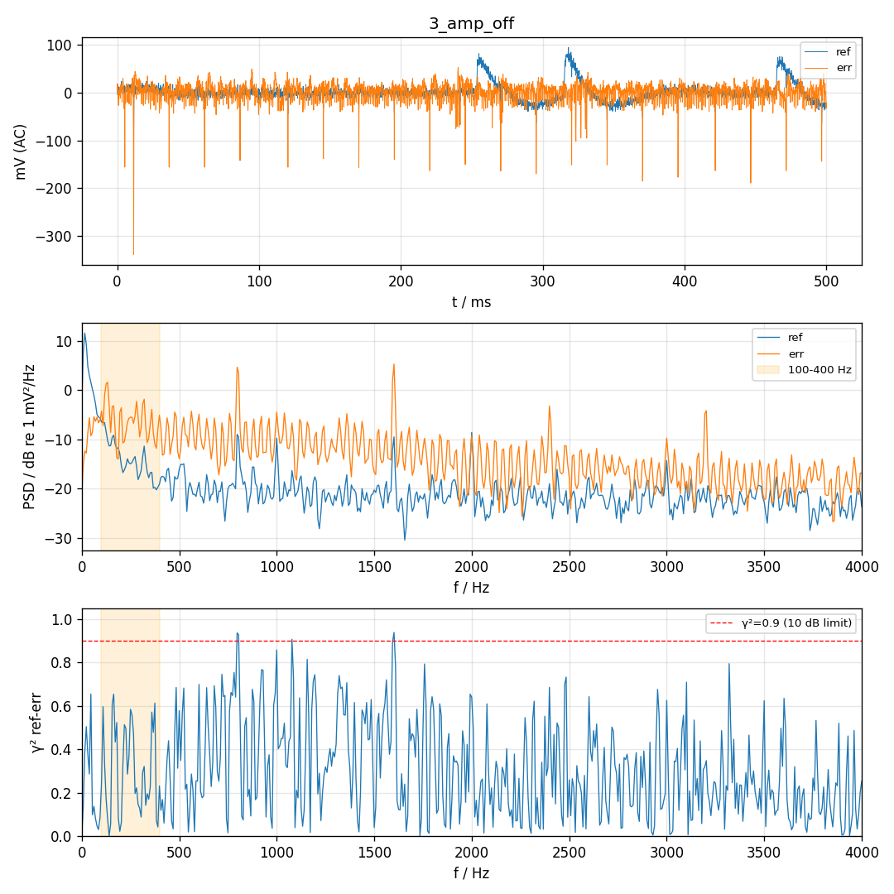

# P0 硬件对照 2026-11-10 12:20:22

帧数 4000，喇叭 300 Hz amp 0.02，声源 200 Hz，ref 目标 200–300 mV

| 段 | 单音 Hz | ref 单音 mV | err 单音 mV | ref−err dB | ref 3 次谐波 dB | err <80 Hz mV | err >80 Hz mV | ref clip | err clip | 同步跳变 |
| --- | --- | --- | --- | --- | --- | --- | --- | --- | --- | --- |
| 0_quiet | 300 | 0.1 | 0.7 | -19.7 | 0.7 | 3.2 | 41.3 | 0 | 0 | - |
| 1_spk_on | 300 | 70.5 | 447.0 | -16.0 | -31.4 | 14.1 | 448.6 | 0 | 0 | - |
| 2_spk_unplugged | 300 | 0.0 | 0.3 | -30.6 | 23.5 | 1.9 | 16.9 | 0 | 0 | - |
| 3_amp_off | 300 | 0.1 | 0.3 | -7.1 | 4.1 | 3.3 | 20.6 | 0 | 0 | - |

| 项目 | 结果 | 说明 |
| --- | --- | --- |
| 喇叭幅度 | PASS | 选用 amp 0.02；amp 0.02: ref clip=0 量程 24%，err clip=0 量程 47% |
| err 声学路径断开 | PASS | 300 Hz：接喇叭 447.0 → 拔线 0.3 mV（-62.3 dB，本底 0.71 mV） |
| ref 电串扰·功放通电 | PASS | 300 Hz：接喇叭 70.5 mV → 拔线 0.0 mV（-76.9 dB，本底 0.07 mV），约 0% 来自电路 |
| ref 电串扰·功放断电 | PASS | 300 Hz：接喇叭 70.5 mV → 断电 0.1 mV（-54.0 dB，本底 0.07 mV），约 0% 来自电路 |
| 串扰位置 | PASS | 参考麦里没有可测的电串扰；喇叭测试时参考麦削波是声学原因（喇叭支管离参考麦近），降低喇叭幅度即可。接喇叭时 err 相对 ref +11.0 样本（模 26.7），按几何应 -3.0 |
| MCU 同步干扰 | PASS | 没有与 128 样本块同步的跳变 |

