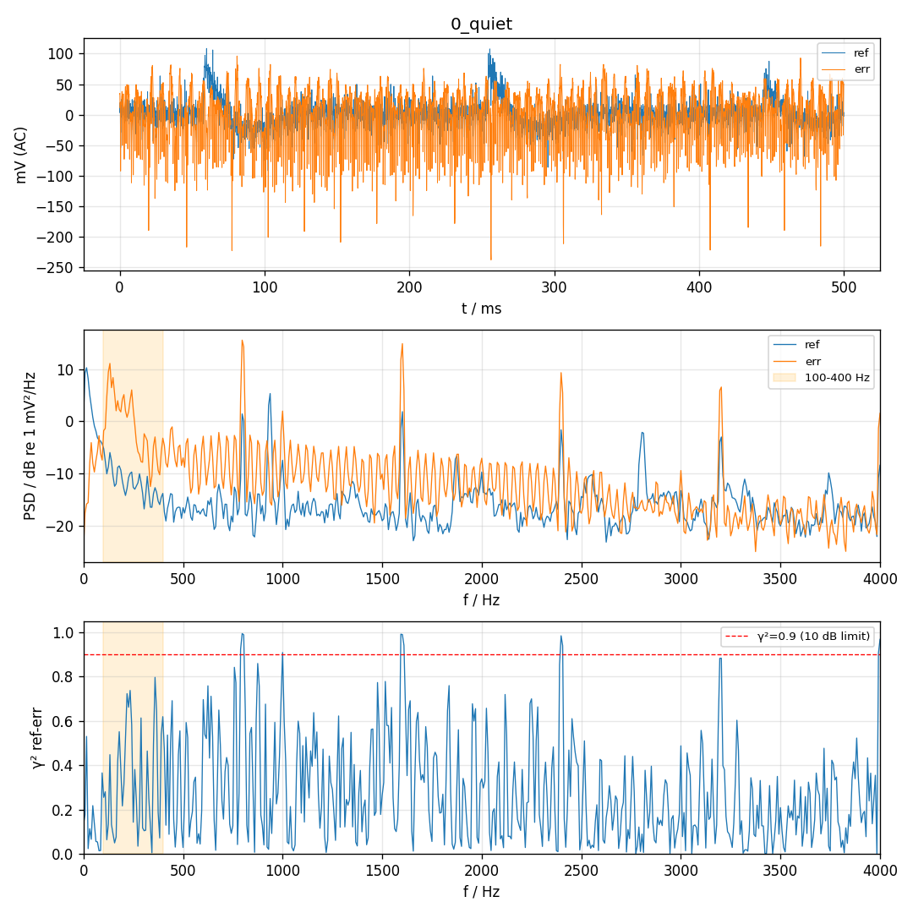
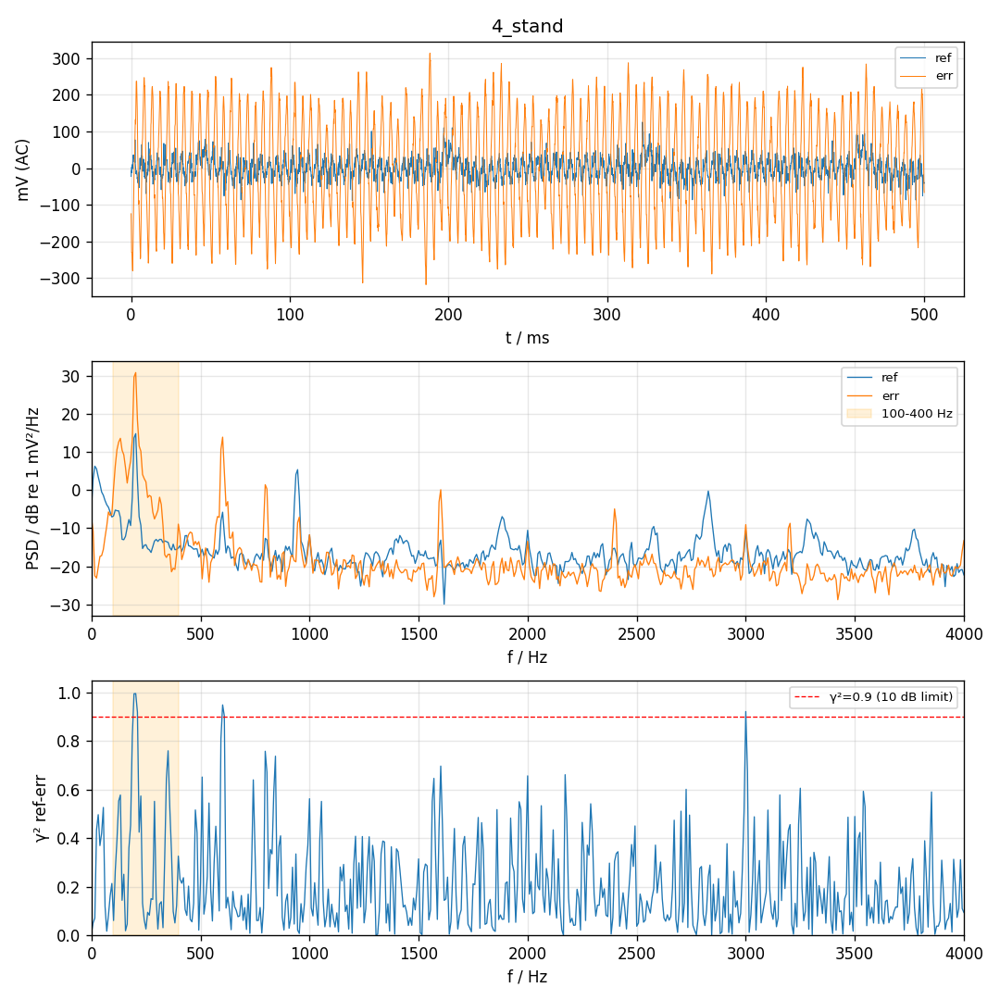
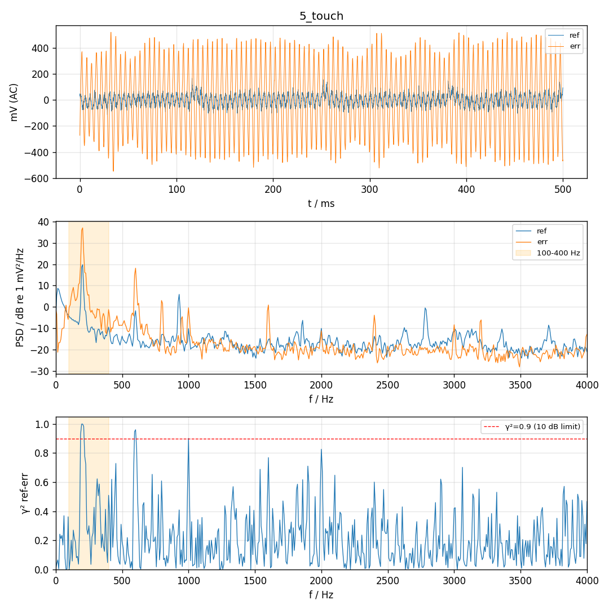
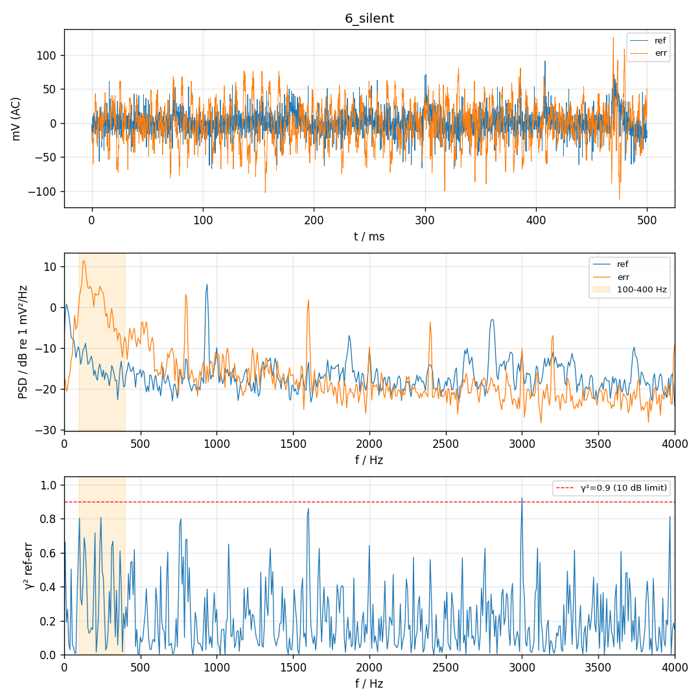

# P0 硬件对照 2026-11-10 15:20:34

帧数 4000，喇叭 300 Hz amp -，声源 200 Hz，ref 目标 80–200 mV

| 段 | 单音 Hz | ref 单音 mV | err 单音 mV | ref−err dB | ref 3 次谐波 dB | err <80 Hz mV | err >80 Hz mV | ref clip | err clip | 同步跳变 |
| --- | --- | --- | --- | --- | --- | --- | --- | --- | --- | --- |
| 0_quiet | 300 | 0.5 | 0.7 | -3.4 | -7.5 | 4.1 | 43.8 | 0 | 0 | - |
| 0_quiet@200Hz | 200 | 0.5 | 3.5 | -16.1 | -3.4 | 4.1 | 43.8 | 0 | 0 | - |
| 4_stand | 200 | 20.8 | 132.6 | -16.1 | -21.9 | 5.4 | 137.7 | 0 | 0 | - |
| 5_touch | 200 | 37.3 | 272.0 | -17.3 | -22.0 | 14.9 | 276.7 | 0 | 0 | - |
| 6_silent | 200 | 0.2 | 1.5 | -17.8 | 6.9 | 3.1 | 28.7 | 0 | 0 | - |

| 项目 | 结果 | 说明 |
| --- | --- | --- |
| ref 声源电平 | WARN | ref 21 mV（目标 80–200）  → 调手机音量调大 |
| ref 不削波 | PASS | 占用量程 6%，clip=0 |
| err 不削波 | PASS | 占用量程 19%，clip=0 |
| ref 谐波 | WARN | ref 2/3 次 -36/-22 dB，err 2/3 次 -40/-18 dB  两麦都有 → 手机喇叭失真，调小音量 |
| 低频来源 | WARN | err <80 Hz：静音 4.1 / 支架 5.4 / 贴管 14.9 / 静音文件 3.1 mV。碰管/手扶会带进明显低频振动 → 手机必须用支架、不碰管 |
| MCU 同步干扰 | PASS | 没有与 128 样本块同步的跳变 |

