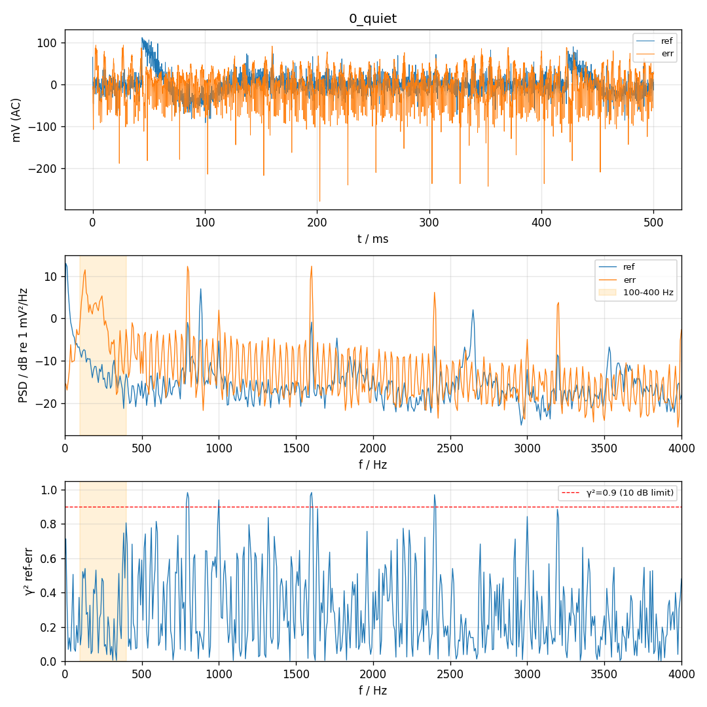
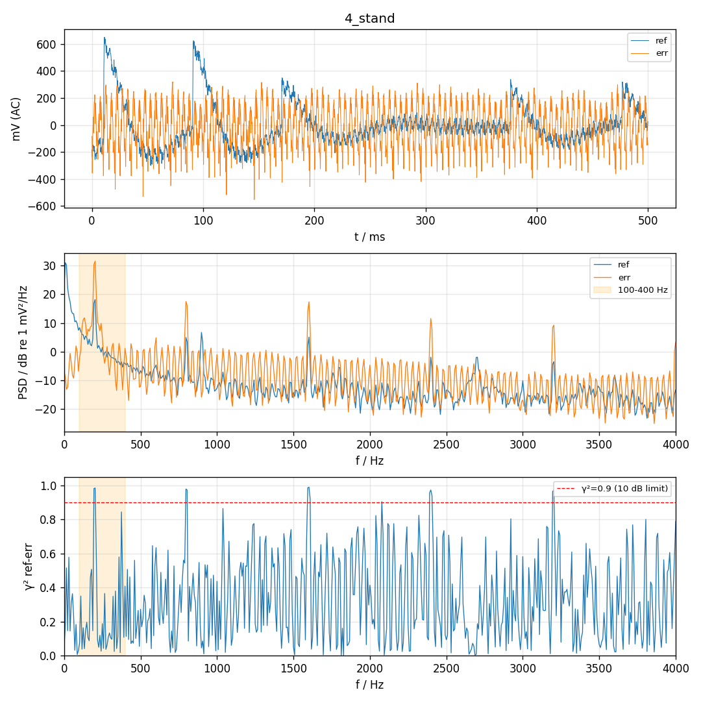
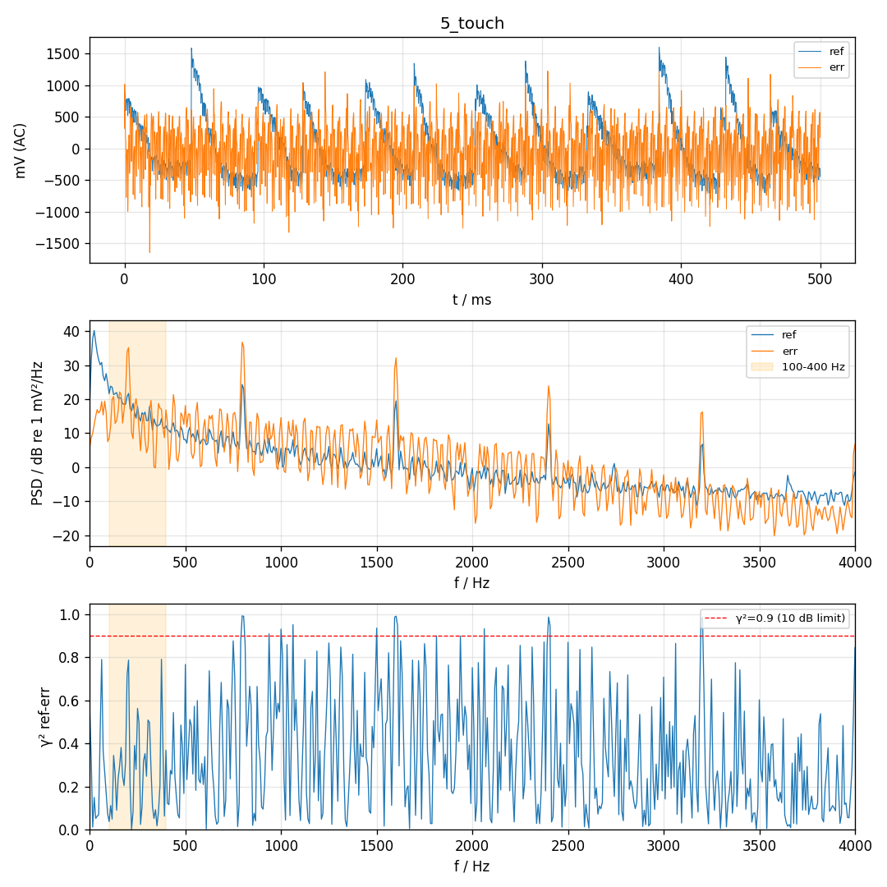
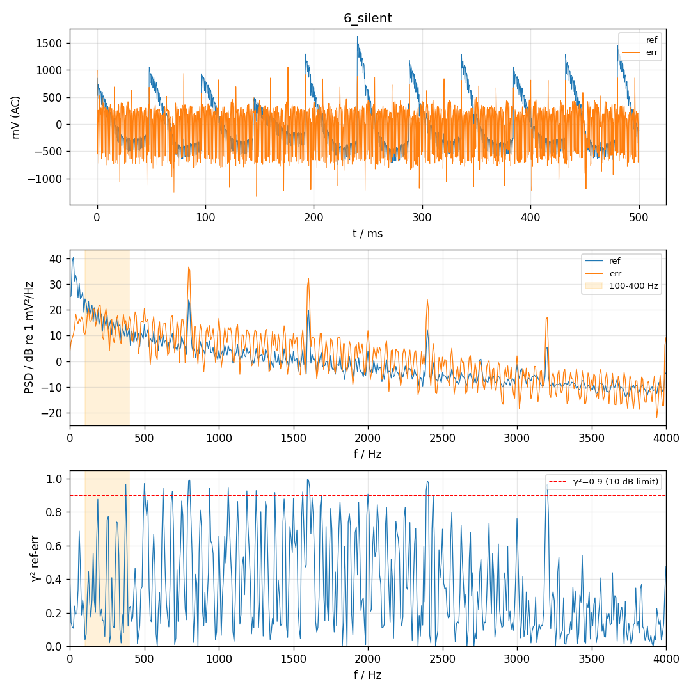

# P0 硬件对照 2026-11-10 15:31:04

帧数 4000，喇叭 300 Hz amp -，声源 200 Hz，ref 目标 80–200 mV

| 段 | 单音 Hz | ref 单音 mV | err 单音 mV | ref−err dB | ref 3 次谐波 dB | err <80 Hz mV | err >80 Hz mV | ref clip | err clip | 同步跳变 |
| --- | --- | --- | --- | --- | --- | --- | --- | --- | --- | --- |
| 0_quiet | 300 | 0.3 | 0.7 | -6.7 | -1.9 | 3.3 | 38.1 | 0 | 0 | - |
| 0_quiet@200Hz | 200 | 0.8 | 3.4 | -12.0 | -4.0 | 3.3 | 38.1 | 0 | 0 | - |
| 4_stand | 200 | 30.4 | 142.2 | -13.4 | -27.7 | 6.3 | 154.2 | 0 | 0 | - |
| 5_touch | 200 | 38.4 | 212.9 | -14.9 | -20.5 | 49.8 | 409.8 | 0 | 1 | ref 6.1× err 2.5× |
| 6_silent | 200 | 2.3 | 27.7 | -21.4 | 4.0 | 65.7 | 349.4 | 1 | 0 | ref 6.0× err 2.5× |

| 项目 | 结果 | 说明 |
| --- | --- | --- |
| ref 声源电平 | WARN | ref 30 mV（目标 80–200）  → 调手机音量调大 |
| ref 不削波 | PASS | 占用量程 29%，clip=0 |
| err 不削波 | PASS | 占用量程 26%，clip=0 |
| ref 谐波 | WARN | ref 2/3 次 -26/-28 dB，err 2/3 次 -32/-28 dB  两麦都有 → 手机喇叭失真，调小音量 |
| 低频来源 | WARN | err <80 Hz：静音 3.3 / 支架 6.3 / 贴管 49.8 / 静音文件 65.7 mV。5_touch, 6_silent 有 MCU 同步干扰，低频来源无法判断，排除干扰后重测 |
| MCU 同步干扰 | FAIL | 5_touch: ref 块边界跳变是其余位置的 6.1 倍（45 个大跳变，24% 落在 128 样本边界） err 块边界跳变是其余位置的 2.5 倍（45 个大跳变，20% 落在 128 样本边界）；6_silent: ref 块边界跳变是其余位置的 6.0 倍（44 个大跳变，36% 落在 128 样本边界） err 块边界跳变是其余位置的 2.5 倍（47 个大跳变，26% 落在 128 样本边界）  → 与固件处理块（16 ms）同步，不是声音：对照 0 段时的功放/喇叭接线和地线；手机拿远、喇叭 STOP 时用 capture 复查，再拔喇叭线复查（消失 → 喇叭在放 DAC 线上的噪声；仍在 → 地线/接线耦合） |

