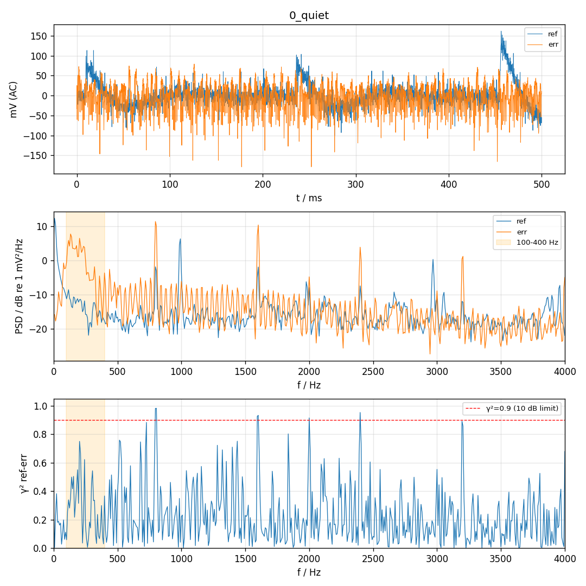
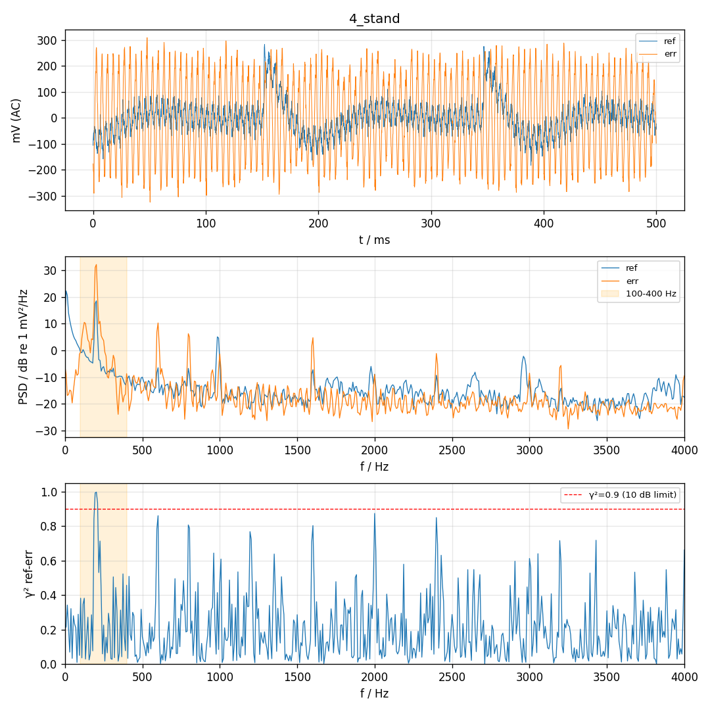
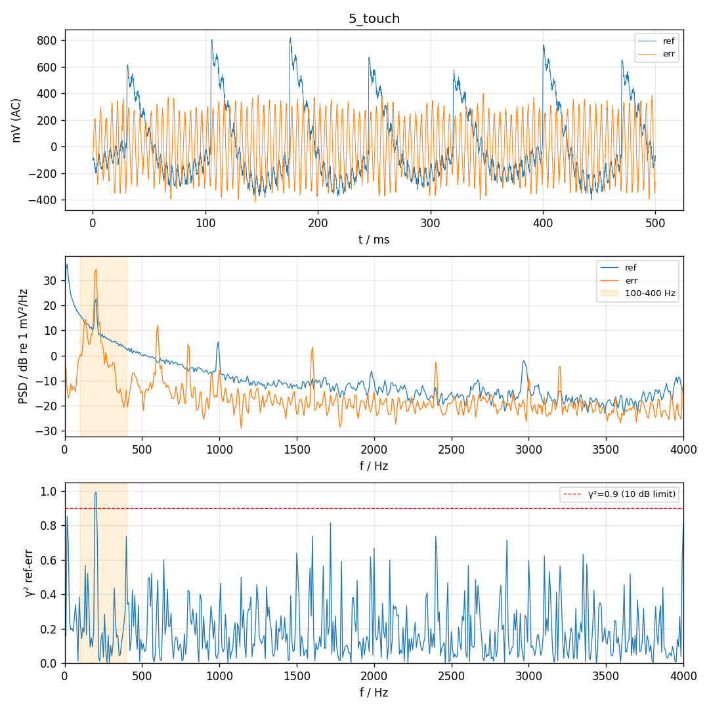
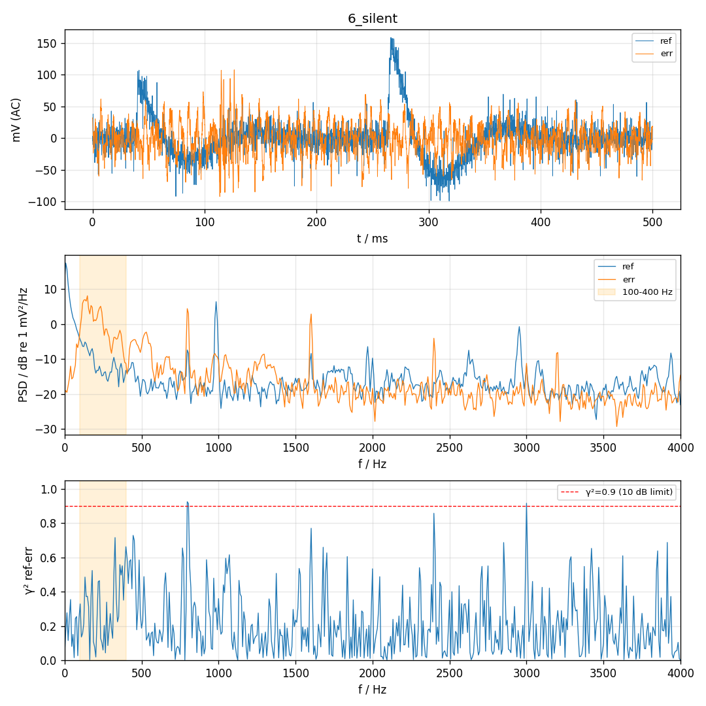

# P0 硬件对照 2026-11-10 15:41:52

帧数 4000，喇叭 300 Hz amp -，声源 200 Hz，ref 目标 80–200 mV

| 段 | 单音 Hz | ref 单音 mV | err 单音 mV | ref−err dB | ref 3 次谐波 dB | err <80 Hz mV | err >80 Hz mV | ref clip | err clip | 同步跳变 |
| --- | --- | --- | --- | --- | --- | --- | --- | --- | --- | --- |
| 0_quiet | 300 | 0.3 | 0.6 | -6.2 | -1.2 | 3.2 | 31.3 | 0 | 0 | - |
| 0_quiet@200Hz | 200 | 0.9 | 4.1 | -13.4 | -11.2 | 3.2 | 31.3 | 0 | 0 | - |
| 4_stand | 200 | 32.0 | 152.8 | -13.6 | -27.0 | 7.9 | 155.9 | 0 | 0 | - |
| 5_touch | 200 | 50.5 | 200.0 | -12.0 | -28.7 | 6.6 | 203.6 | 0 | 0 | - |
| 6_silent | 200 | 0.2 | 1.8 | -18.8 | -2.3 | 2.5 | 24.3 | 0 | 0 | - |

| 项目 | 结果 | 说明 |
| --- | --- | --- |
| ref 声源电平 | WARN | ref 32 mV（目标 80–200）  → 调手机音量调大 |
| ref 不削波 | PASS | 占用量程 14%，clip=0 |
| err 不削波 | PASS | 占用量程 19%，clip=0 |
| ref 谐波 | WARN | ref 2/3 次 -34/-27 dB，err 2/3 次 -42/-23 dB  两麦都有 → 手机喇叭失真，调小音量 |
| 低频来源 | WARN | err <80 Hz：静音 3.2 / 支架 7.9 / 贴管 6.6 / 静音文件 2.5 mV。低频跟播放内容有关（循环接缝咔哒或手机喇叭低频）→ 换长的无缝文件 |
| MCU 同步干扰 | PASS | 没有与 128 样本块同步的跳变 |

