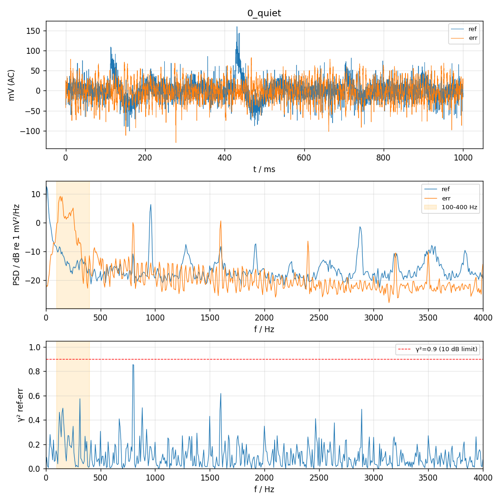
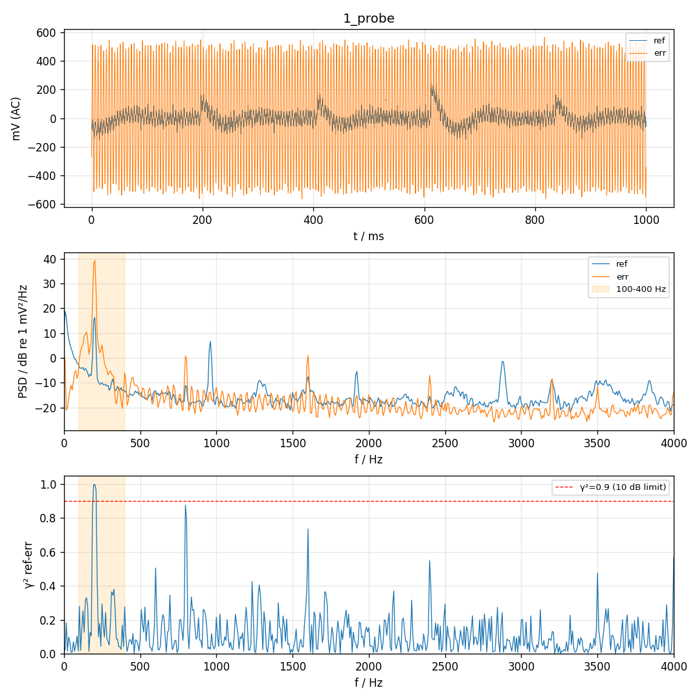
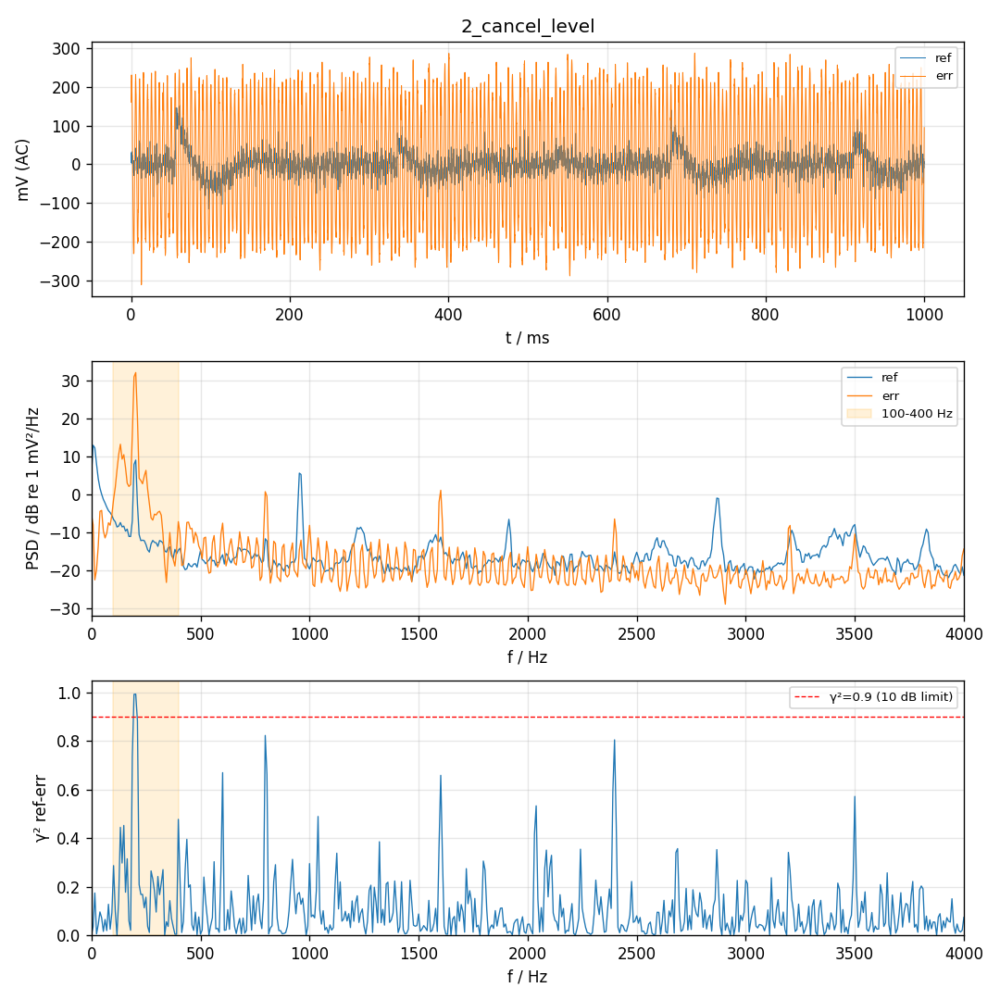

# 回流测量 2026-11-10 17:35

手机停，喇叭单独放 200 Hz。对照是 `20261110_154011_p0test` 支架段：ref 32.0 mV，err 152.8 mV。单音幅度是正弦拟合的 rms。喇叭测完已 STOP。

| 段 | amp | ref @200 Hz | err @200 Hz | DAC rms | ref 滞后 | err 滞后 |
| --- | ---: | ---: | ---: | ---: | ---: | ---: |
| 0_quiet | 0 | 0.29 mV | 1.67 mV | — | — | — |
| 1_probe | 0.010 | 24.82 mV | 353.29 mV | 14.28 码 | +4.21 样本 | +2.38 样本 |
| 2_cancel_level | 0.00433 | 10.76 mV | 153.43 mV | 6.20 码 | +4.15 样本 | +2.35 样本 |

两档没有削波，`ovr=udr=0`。前后半段相位差 0.1° / 0.4°，200 Hz 是稳定的单音，不是本底碰巧拟合出来的。

抵消档是按上一档线性缩到误差麦 153 mV 的幅度。实测 ref 10.76 mV，和 24.82×153.43/353.29 = 10.78 mV 一致，这一段是线性的。

## 圈的放大倍数

喇叭调到刚好抵消误差麦的 153 mV 时，参考麦听到的回流是 **10.8 mV**。手机在参考麦上是 **32 mV**。

\[
|FW| = 10.8 / 32 = 0.34 \quad (-9.5\,\mathrm{dB})
\]

固定在这个抵消增益上，任意相位绕一圈后都不到 1，不会自己越滚越大。余量是 9.5 dB。回流大约是参考信号的三分之一，压得住，但不是小到可以不管。自适应如果冲过抵消点，这 9.5 dB 会被吃掉。

参考麦比误差麦晚 1.8 个样本，声音是从喇叭往上游走的。

