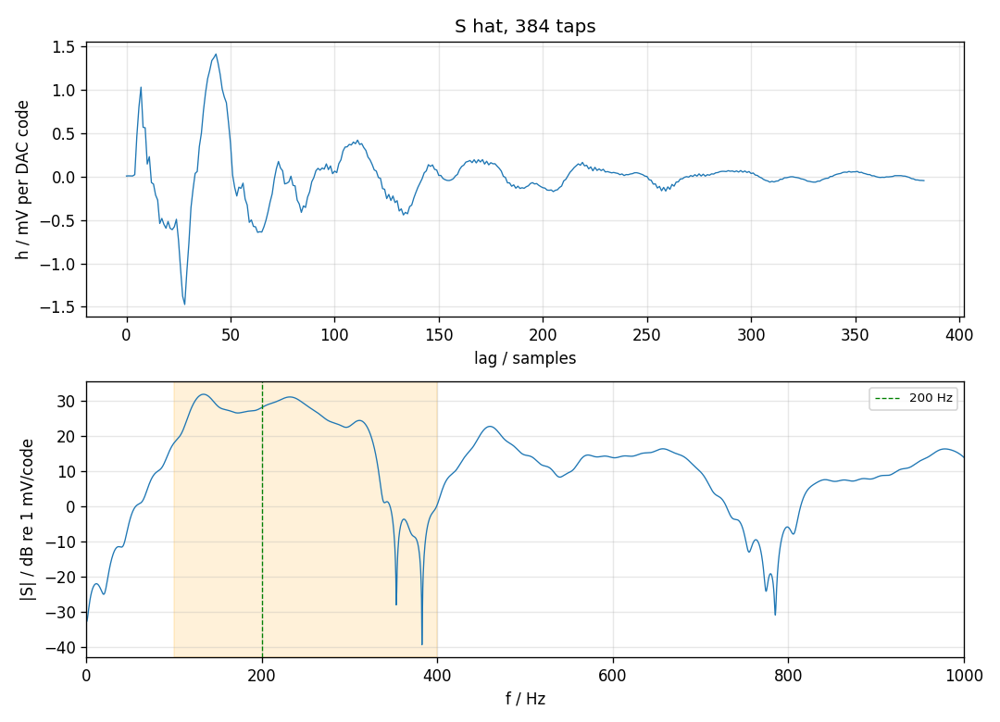

# 次级路径辨识 2026-11-10

三段白噪声，DAC 与误差麦逐帧对齐：`165959_sid_a`、`170008_sid_b`、`170017_sid_c`（NOISE 0.03，各 10666 帧）。回归量是 DAC 码减 2048，不是参考麦。三段叠在一起做最小二乘，段与段的接缝不进方程。

Ŝ 是 **384** 阶，单位 mV / DAC 码，`shat.npz` 的 `h_err`。`h[k]` 是误差麦相对 DAC 晚 k 个样本的系数。

| | |
| --- | --- |
| 留一段验证，100–400 Hz NMSE | -18.0, -18.4, -18.2 dB |
| 三段各自拟合的冲激响应互差 | -30.9, -31.3, -30.3 dB |
| Ŝ(200 Hz) | 25.49 mV/码，-21.0° |
| 随后的 200 Hz 单音（amp 0.00433） | 实测 153.4 mV，Ŝ 预测 157.1 mV，相位差 +0.21° |
| 16:28 那三段用这只 Ŝ 去预测 | NMSE -17.5 / -18.1 / -17.5 dB |

阶数：只用第一段拟合，后两段的 100–400 Hz NMSE 平均为 128 阶 -11.1 dB, 256 阶 -16.8 dB, 384 阶 -18.3 dB, 512 阶 -18.5 dB。384 再加到 512 只多约 0.3 dB，取 384。

100–400 Hz 里 |Ŝ| 高于 20 mV/码的峰：133 Hz 39.1 mV/码（比 200 Hz 高 3.7 dB），232 Hz 35.8 mV/码（比 200 Hz 高 2.9 dB）。350 Hz 处 0.46 mV/码，比 200 Hz 低 35 dB。232 Hz 是次级路径自己的峰，不是回流放大倍数的测量；参考麦那条回路的相干只有 0.5 左右，不能据此说圈在那儿更大。

同一拟合给出的参考麦通路 `h_ref` 在 200 Hz 是 1.69 mV/码、-42.2°，和回流测量的 1.74 mV/码同一量级。参考麦里还有一半以上能量和 DAC 不相干，`h_ref` 只描述其中对得上的那部分。

