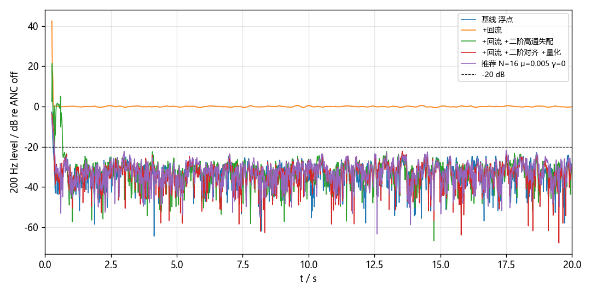
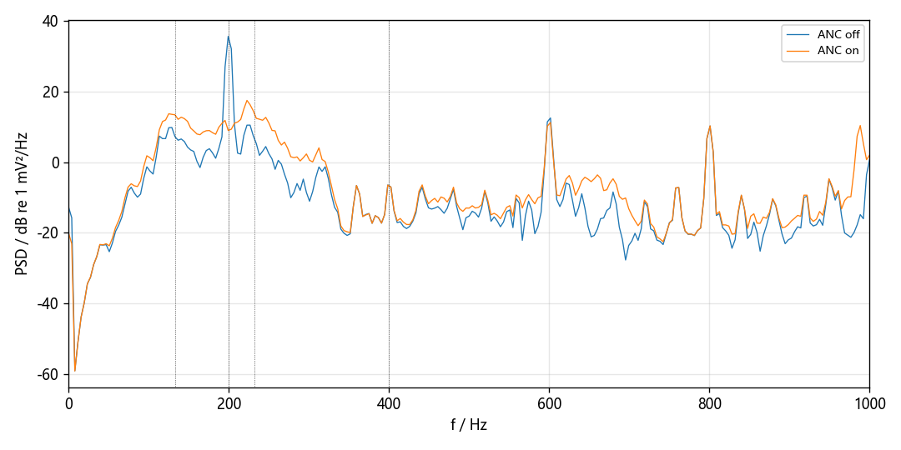
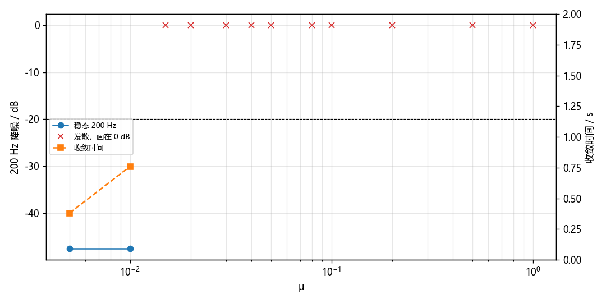

# P3 离线 FxNLMS 2026-11-10

只在电脑上跑。真实次级路径是 `shat.npz` 的 `h_err`（384 阶）。算法里的 Ŝ 是 `20261110_162814_sid_a` 单独最小二乘的 384 阶，和真路径的冲激响应差 -27.3 dB。这段没有进 `shat.npz`。

## 盘点

全部 8 kHz。削波列是 ref/err 的削波点数。200 Hz 是正弦拟合 rms。6–16 Hz 是 Welch 谱在这个带里的积分，不是窄带 IIR。

| 段 | 文件 | 帧 | 秒 | fs | 削波 ref/err | ref 200 Hz mV | err 200 Hz mV | err 相对 ref 样本 | ref 6–16 Hz | err 6–16 Hz |
| --- | --- | ---: | ---: | ---: | --- | ---: | ---: | ---: | ---: | ---: |
| 手机支架 200 Hz，喇叭未出声 | `20261110_154011_p0test/4_stand.npz` | 4000 | 0.500 | 8000 | 0/0 | 32.00 | 152.74 | +10.64 | 38.1 | 0.2 |
| 手机贴管 | `20261110_154011_p0test/5_touch.npz` | 4000 | 0.500 | 8000 | 0/0 | 50.46 | 199.93 | +10.36 | 243.8 | 0.8 |
| 外部声源停，0_quiet | `20261110_154011_p0test/0_quiet.npz` | 4000 | 0.500 | 8000 | 0/0 | 0.88 | 4.10 | -2.33 | 15.6 | 0.4 |
| 播放静音文件 | `20261110_154011_p0test/6_silent.npz` | 4000 | 0.500 | 8000 | 0/0 | 0.20 | 1.73 | +16.24 | 28.4 | 0.3 |
| fb200 静音 | `20261110_173557_fb200/0_quiet.npz` | 8000 | 1.000 | 8000 | 0/0 | 0.29 | 1.67 | +0.64 | 14.9 | 0.3 |
| fb200 抵消档，喇叭 200 Hz | `20261110_173557_fb200/2_cancel_level.npz` | 8000 | 1.000 | 8000 | 0/0 | 10.76 | 153.43 | -1.81 | 15.0 | 0.2 |
| fb200 探针 amp 0.01 | `20261110_173557_fb200/1_probe.npz` | 8000 | 1.000 | 8000 | 0/0 | 24.82 | 353.29 | -1.83 | 30.3 | 0.2 |

单段最长 1 s。没有把短录音首尾接起来。

合成：从 `4_stand` 拟合 200 Hz 和 600 Hz 的幅度、相位（600 Hz 是手机的三次谐波，误差麦上大约 −23 dB），从减去这两条线之后的残差估计 Welch 谱，再按这个谱造 20 s 随机相位噪声，最后把正弦加回去。

| 校验 | 录音 | 合成 |
| --- | ---: | ---: |
| ref 200 Hz mV | 32.00 | 32.12 |
| err 200 Hz mV | 152.74 | 149.82 |
| err 比 ref 晚的样本 | 10.64 | 10.67 |
| 残差 ref 6–16 Hz mV | 38.1 | 43.9 |
| 残差 err 6–16 Hz mV | 0.2 | 0.4 |

贴管段 6–16 Hz 的参考麦按 Welch 是 243.8 mV。讨论记录里的约 262 mV 是窄带 IIR 算的，那只滤波器在 8 kHz 上会把 200 Hz 漏进 6–16 Hz。冲击用 Welch 的数，只加在参考麦上。

回流取抵消档：1.735 mV/码，参考麦晚 4.15 个样本（-37.4°）。探针档 1.738 mV/码、4.21 样本，同一条增益。

## 假设

- 逐点：本拍算出的 DAC 从下一拍才进入两条声学路径。辨识出的 FIR 描述的是「DAC 脚上的码和同一拍的麦」，所以仿真里真路径和回流都多这 1 拍。200 Hz 上是 9°。算法内部的 Ŝ 滤波可以用到当前参考样本，那不是声学延迟。
- 更新是减号：`w ← (1−γ) w − μ e x' / (‖x'‖²+ε)`。麦上是 d 加喇叭，写成加号会往反方向走。ε = 1。
- 回流 F 用的是 200 Hz 上测到的增益和延迟，实现成「增益 × 分数延迟」，所以全频带都乘了同一个数。10 Hz 上真路径 |S| 只有 0.078 mV/码，这条 F 是 1.73 mV/码，比 S 大约 27 dB。离开 200 Hz 之后 F 没有测过，不能把「不加高通就发散」当成管子一定会叫。
- 200 Hz 降噪有两个数。4 s 正弦拟合只看锁相的单音。0.25 s 相干包络的最后 4 s 中位数会把相位在漂的残差也算进去，所以比拟合浅。收敛时刻按这只包络：降到它自己的中位数 +3 dB 以内，并且接下来 0.5 s 里八成的点还在门限下。
- 高通是因果 Butterworth，截止 80 Hz。对齐是指滤波后的 x' 再过同一只高通；失配是 x' 不过。
- 量化：四舍五入到整数码，并限制在 −2048…2047。
- 相位扫描在 200 Hz 上是准确的常数相位（用 10 个样本的正交分量）。别的频率不是同一角度。
- 保护规则是仿真里定的，不是从板上测到的：误差麦短时 rms（50 ms）连续 4 窗高于开环 rms 的 2 倍就清零 W 并静音。开环 rms 约 154 mV。

## 逐项，N=16，μ=0.01，γ=0.0

这一组参数没有为了过线再改。

| 条件 | 4 s 拟合 | 0.25 s 窗 | 收敛 | y rms 码 | 末尾 4 s 峰值码 |
| --- | ---: | ---: | --- | ---: | ---: |
| 基线 浮点 | -38.4 | -31.9 | 0.31 s | 11.13 | 46.1 |
| +回流 | +0.0 | +0.0 | 未收敛 | 0.00 | 0.0 |
| +回流 +一阶高通失配 | +0.0 | +0.0 | 未收敛 | 0.00 | 0.0 |
| +回流 +二阶高通失配 | -47.4 | -32.4 | 0.78 s | 7.51 | 26.2 |
| +回流 +一阶高通对齐 | -48.2 | -33.3 | 0.74 s | 10.40 | 40.5 |
| +回流 +二阶高通对齐 | -47.9 | -32.8 | 0.92 s | 7.30 | 27.7 |
| +回流 +一阶对齐 +量化 | -48.4 | -33.4 | 0.76 s | 9.37 | 36.0 |
| +回流 +二阶对齐 +量化 | -47.6 | -32.9 | 0.76 s | 9.17 | 41.0 |

「+回流」一行如果发散，末尾的 0 dB 是因为 |y| 超过 1e6 之后把输出清零了，不是它还停在开环。N=16、μ=0.01、没有高通、输出再限到 DAC 范围时，输出会一直顶在 ±2048，200 Hz 也不降。加上二阶高通之后就稳住了。一阶高通如果不把同一只高通卷进 Ŝ，这一档 μ 也会发散；卷进去就和二阶一样。

## 抽头（回流 + 二阶对齐 + 量化，μ=0.01，γ=0）

| N | 4 s 拟合 | 0.25 s 窗 | 收敛 |
| --- | ---: | ---: | --- |
| 4 | +0.1 | +0.0 | 未收敛 |
| 8 | -28.8 | -27.5 | 0.30 s |
| 16 | -47.6 | -32.9 | 0.76 s |
| 32 | -42.7 | -32.9 | 0.36 s |

取稳态拟合最深、且仍 ≤ −20 dB 的 N = 16。

## μ（N=16，二阶对齐，量化，回流，γ=0）

稳定上界（能降过 10 dB 且没有顶满 DAC 的最大扫描点）= 0.01。再大一档就是表里的下一个点，上界在这两档之间，没有更密的测量。

| μ | 4 s 拟合 | 0.25 s 窗 | 收敛 | 发散 |
| --- | ---: | ---: | --- | ---: |
| 0.005 | -47.6 | -31.4 | 0.38 s | 否 |
| 0.01 | -47.6 | -32.9 | 0.76 s | 否 |
| 0.015 | +0.0 | +0.0 | 未收敛 | 是 |
| 0.02 | -0.0 | +0.0 | 未收敛 | 是 |
| 0.03 | +0.0 | +0.0 | 未收敛 | 是 |
| 0.04 | -0.0 | +0.0 | 未收敛 | 是 |
| 0.05 | -0.0 | +0.0 | 未收敛 | 是 |
| 0.08 | +0.0 | +0.0 | 未收敛 | 是 |
| 0.1 | -0.0 | +0.0 | 未收敛 | 是 |
| 0.2 | +0.0 | +0.0 | 未收敛 | 是 |
| 0.5 | -0.0 | +0.0 | 未收敛 | 是 |
| 1 | -0.0 | +0.0 | 未收敛 | 是 |

推荐 μ = 0.005。下一档 0.015 就顶满 DAC，上界在 0.01 和 0.015 之间。

## 泄漏（在推荐 μ 上）

| γ | 4 s 拟合 | 0.25 s 窗 | 收敛 |
| --- | ---: | ---: | --- |
| 0 | -47.6 | -31.4 | 0.38 s |
| 1e-06 | -47.6 | -31.5 | 0.38 s |
| 1e-05 | -42.2 | -31.2 | 0.34 s |
| 0.0001 | -27.6 | -26.3 | 0.28 s |
| 0.001 | -10.8 | -10.8 | 0.25 s |

推荐 γ = 0。γ=0 已经在 1 s 内收敛。1e-6 和 0 没有差别，1e-5 开始把 4 s 拟合变浅。不拿深度去换泄漏。

## Ŝ 相位误差

相位是加在滤波后的 x' 上的，只在 200 Hz 准确。

| 相位 ° | 4 s 拟合 | 0.25 s 窗 | 收敛 |
| --- | ---: | ---: | --- |
| +0 | -47.6 | -31.4 | 0.38 s |
| +15 | -44.0 | -31.3 | 0.35 s |
| +30 | -41.6 | -31.1 | 0.36 s |
| +45 | -40.0 | -30.6 | 0.39 s |
| +60 | -39.1 | -29.7 | 0.43 s |
| +75 | -38.9 | -27.4 | 0.72 s |
| +90 | -15.6 | -12.6 | 0.40 s |
| -15 | -56.8 | -31.4 | 0.48 s |
| -30 | -54.4 | -31.0 | 0.73 s |
| -45 | -47.3 | -29.7 | 0.74 s |
| -60 | -44.3 | -27.5 | 0.46 s |
| -75 | -43.1 | -22.1 | 0.45 s |
| -90 | +0.0 | +0.0 | 未收敛 |

## 参考麦 6–16 Hz 冲击

加在参考麦上的带限噪声，rms 等于贴管录音的 6–16 Hz。误差麦不加。不确定碰管子时误差麦实际吃进多少，这段录音里误差麦 6–16 Hz 只有 0.8 mV。

| 高通阶数 | 4 s 拟合 | 0.25 s 窗 | 收敛 | 平均 1/(‖x'‖²+ε) | y rms |
| --- | ---: | ---: | --- | ---: | ---: |
| 0 | -39.7 | -30.6 | 0.74 s | 8.464e-08 | 31.80 |
| 1 | -48.9 | -31.7 | 0.75 s | 1.116e-07 | 10.14 |
| 2 | -47.3 | -31.4 | 0.34 s | 8.726e-08 | 7.53 |

`1/(‖x'‖²+ε)` 变小就是归一化步长被压短。无冲击、二阶高通那次是 8.687e-08。

## 副作用（推荐的那一次，最后 8 s）

| Hz | 关 dB | 开 dB | 开−关 |
| --- | ---: | ---: | ---: |
| 133 | 7.2 | 13.4 | +6.2 |
| 199 | 35.7 | 9.0 | -26.7 |
| 230 | 7.5 | 14.6 | +7.1 |
| 398 | -6.5 | -6.5 | -0.0 |

100–400 Hz 总能量：关 43.7 dB，开 33.9 dB，差 -9.8 dB。谱是 Welch，dB re 1 mV²/Hz，和上面的正弦幅度 dB 不是同一种数。230 Hz 附近这一格是 +7.1 dB，绝对高度仍低于关环时的 200 Hz 线。

## 保护

| 情况 | 静音时刻 s | 触发前 \|e\| 峰值 mV | 数值炸掉 | 末尾 200 Hz |
| --- | ---: | ---: | ---: | ---: |
| 推荐参数，保护开着 | nan | 546 | 0 | -47.6 |
| 相位 180° | 0.200 | 82989 | 0 | -0.0 |
| μ×10 | 0.200 | 17934 | 0 | -0.0 |

静音时刻从仿真起点算。NaN 表示这 20 s 里规则没有触发。阈值是开环 rms 的 2 倍，连续 4 个 50 ms 窗，最快 0.20 s。末尾 200 Hz 在静音之后回到开环，所以是 0 dB 左右，不代表没检测到。

## 推荐和合格线

推荐：N = 16，μ = 0.005，γ = 0，二阶 80 Hz 因果高通并且卷进 Ŝ，DAC 限幅 −2048…2047 码。末尾 4 s 的 y 峰值 25.0 码，整段峰值 30 码。没有碰到限幅。

这一次：4 s 正弦拟合 -47.6 dB，0.25 s 窗中位数 -31.4 dB，收敛 0.38 s，y rms 7.28 码。合格线（回流、对齐后的高通、整数量化之后，两个降噪数都 ≤ −20 dB，且 1 s 内收敛）达到。

## 哪些是实测，哪些是假设

实测：初级路径的 200 Hz 和 600 Hz 幅度相位，残差的频谱，Ŝ 和另一段白噪声的 Ŝ，回流在 200 Hz 的复增益，DAC 码的范围，采样率。

假设：20 s 噪声是按谱重新抽的，不是那半秒的重复；F 在 200 Hz 以外等于同一个增益和延迟；逐点多 1 拍；高通阶数和截止是预定的，不是从板上拆出来的；保护阈值是这里定的；碰管子只加在参考麦上。
